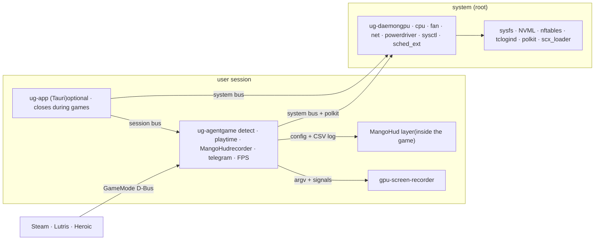

<!--
10 — Roadmap (approved plan, Persian)

This is the build roadmap exactly as the user approved it on 2026-09-14. It was
also published as a page, https://claude.ai/artifact/KNhtWo36zHutPKv7UKuMw6,
whose sharing the user controls. It is the *plan*; it is not updated as work
happens.

- Progress per task (0.1 … 10.8):      04-status.md
- Where the build deliberately differs: 02-decisions.md, section C
- Measured facts that changed plans:    05-findings.md

Estimates assume one person full-time (×2 part-time). Written in Persian because
that is how the user reads it; task IDs, code and paths are the same in every
document.
-->

Build Roadmap · v1.0

# رودمپ ساخت Unix Guardian

ابزار متن‌باز و رایگان گیمینگ برای لینوکس: حالت گیمینگ، تیون GPU، کرو فن، کنترل سیستم، مانیتورینگ، پایداری پینگ، اورلی، ضبط، کنترل اینترنت، تایم‌پلی و عیب‌یاب درایور — روی همه‌ی توزیع‌های اصلی.

## نمای کلی

این سند طوری نوشته شده که بشه از روش خط‌به‌خط پروژه رو ساخت: هر فاز یک هدف، یک زمان تخمینی و یک مایلستون داره؛ هر تسک شناسه، حوزه (daemon / agent / app / pkg)، جزئیات فنی و **معیار پذیرش** داره. تخمین‌ها برای یک نفر **تمام‌وقت** هستن؛ اگه نیمه‌وقت کار می‌کنی حدوداً ×۲ کن.

- **۱۱** فاز (P0 تا P10)
- **۸۴** تسک شماره‌دار
- **~۴۲** هفته تا نسخه‌ی ۱.۰ (تمام‌وقت)
- **۳** پروسه: daemon، agent، app

### ترتیب فازها چرا این‌طوریه

اول چیزی که همه‌ی ماژول‌ها بهش وابسته‌ان (اسکلت D-Bus، خواندن سنسورها، رابط)، بعد قابلیت‌هایی که ریسک فنی کمی دارن و زود «محصول» می‌شن (حالت گیمینگ، کنترل سیستم، شبکه)، بعد ماژول‌های پرریسک (GPU، اورلی، ضبط) و آخر سر عیب‌یاب درایور که به همه‌ی دانش قبلی نیاز داره. بتای عمومی بعد از P6 منتشر می‌شه تا جامعه از همون‌جا کمک کنه.

> **شرط رم و لگ:** رابط Tauri یک پروسه‌ی *اختیاری*ه. کارهای واقعی رو دو باینری Rust انجام می‌دن که مجموعاً زیر ۴۰ مگابایت رم و زیر ۰٫۵٪ CPU می‌مونن. وقتی بازی شروع می‌شه پنجره‌ی رابط بسته می‌شه (فقط آیکون tray می‌مونه) و WebView کاملاً از حافظه خارج می‌شه. این بودجه‌ها در تسک ۱.۹ به تست خودکار تبدیل می‌شن.

## تصمیم‌های ثابت‌شده

این‌ها انتخاب‌هایی هستن که بقیه‌ی سند روشون بنا شده. تغییرشون بعد از P1 هزینه‌ی زیادی داره.

| موضوع | انتخاب | چرا |
|---|---|---|
| زبان هسته | Rust 1.85+ (edition 2024)، tokio | دیمن با root اجرا می‌شه؛ ایمنی حافظه اینجا امنیتیه. LACT و CoolerControl همین مسیر رو رفتن. |
| ساختار پروسه‌ها | `ug-daemon` (root) · `ug-agent` (session کاربر) · `ug-app` (Tauri، اختیاری) | کارهای sysfs/nftables root می‌خوان؛ تشخیص بازی و MangoHud و ضبط به سشن کاربر (Wayland/PipeWire) نیاز دارن؛ رابط باید بشه بست. |
| IPC | D-Bus با `zbus 5` + polkit | استاندارد لینوکس؛ Flatpak و ابزارهای دیگه هم می‌تونن با UG حرف بزنن. |
| رابط | Tauri 2 + Svelte 5 + TypeScript + Tailwind 4؛ نمودار با uPlot؛ فونت Vazirmatn | Svelte بدون VDOM و باندل کوچک؛ uPlot ~۴۰KB و برای داده‌ی زنده سریعه. React و Chart.js حذف شدن. |
| اورلی | MangoHud به‌عنوان موتور (لایه‌ی Vulkan/OpenGL)؛ UG فقط کانفیگ/تم/کلید می‌سازد | روی Wayland (حتی GNOME) و فول‌اسکرین کار می‌کنه؛ ساخت لایه‌ی اختصاصی برای یک نفر توجیه نداره. |
| ضبط | `gpu-screen-recorder` (NVENC/VAAPI/AMF، بافر replay) | دقیقاً همون قابلیت «هایلایت هوشمند» رو داره و Wayland-safe است. |
| لایسنس | GPL-3.0-or-later | اجازه می‌ده در صورت نیاز MangoHud و gpu-screen-recorder رو فورک کنیم یا ازشون کد قرض بگیریم. |
| زمان‌بند | sched_ext از طریق `scx_loader` (D-Bus) | سوییچ زمان‌بند بدون ریبوت وقتی بازی شروع می‌شه؛ کرنل ≥ 6.12. PREEMPT_RT حذف شد. |
| ذخیره‌سازی | SQLite (`rusqlite`) در agent؛ کانفیگ TOML | `/etc/unix-guardian/` برای daemon، `~/.config/unix-guardian/` برای agent و app، `/var/lib/unix-guardian/` برای state. |
| زبان رابط | فارسی (RTL) پیش‌فرض + انگلیسی؛ ترجمه با Paraglide | کلیدهای ترجمه از روز اول؛ Weblate در P10. |
| پلن‌ها | همه‌چیز رایگان، بدون tier | تصمیم محصول: نسخه‌ی لینوکس کاملاً رایگان و متن‌باز. |
| طراحی رابط | هویت بصری مستقل، نه کپی نسخه‌ی ویندوز | تصمیم خودت؛ چیدمان و قابلیت‌ها همان، ظاهر آزاد. |
| هدف GPU | NVIDIA Pascal (GTX 1000) به بالا · AMD RDNA1 (RX 5000) به بالا · Intel Arc فقط مانیتورینگ | Pascal فقط درایور proprietary؛ Turing+ ماژول open. AMD تا RDNA2 ولتاژ دارد، RDNA3/4 فقط offset. |
| توزیع‌ها | **Tier 1:** Arch/CachyOS/Manjaro/EndeavourOS، Debian/Parrot/Ubuntu/Pop/Mint، Fedora/Nobara · **Tier 2:** openSUSE، Bazzite/Silverblue · **Tier 3:** NixOS، Void، Alpine، Gentoo (تشخیص + راهنما) | Debian در Tier 1 چون سیستم روزانه‌ی خودت Parrot است. |
| بسته‌بندی | Native (AUR، deb، rpm) + `install.sh`؛ Flatpak فقط برای رابط در P10 | دیمن root داخل sandbox جا نمی‌شه. |

## معماری

سه پروسه، یک پروتکل. رابط هیچ‌وقت مستقیم به sysfs دست نمی‌زنه؛ همه‌چیز از D-Bus رد می‌شه تا CLI، اسکریپت‌ها و حتی ربات تلگرام همون API رو داشته باشن.



### بودجه‌ی منابع (معیار پذیرش سراسری)

| پروسه | اجرا | RSS حداکثر | CPU حین بازی | یادداشت |
|---|---|---|---|---|
| `ug-daemon` | root · systemd system service · D-Bus activated | ۱۵ MB | < ۰٫۳٪ | حلقه‌ی فن ۱Hz، بقیه event-driven |
| `ug-agent` | کاربر · `systemd --user` · graphical-session | ۲۵ MB | < ۰٫۵٪ | نمونه‌برداری ۱Hz؛ وقتی رابط باز نیست سیگنالی نمی‌فرسته |
| `ug-app` | کاربر · فقط وقتی پنجره بازه | ۱۵۰ MB باز / ۰ بسته | ۰ (پروسه وجود نداره) | WebKitGTK؛ tray در Rust زنده می‌مونه، پنجره destroy می‌شه |

### چیدمان مخزن (monorepo)

```
unix-guardian/
├─ Cargo.toml                 # workspace
├─ rust-toolchain.toml
├─ crates/
│  ├─ ug-proto/      # D-Bus interfaces (zbus traits), shared types, versioning
│  ├─ ug-core/       # profiles, state machine, config loader, error types
│  ├─ ug-testfs/     # fake /sys tree builder for tests
│  ├─ ug-hw/         # hwmon, cpufreq, RAPL, topology (CCD/X3D/SMT), meminfo
│  ├─ ug-gpu/        # trait GpuBackend + nvidia/ (NVML), amd/ (sysfs), intel/
│  ├─ ug-net/        # nftables table, tc shaper, cgroup manager, socket→pid map
│  ├─ ug-power/      # logind, scheduled queue, rtc wake, bootloader entries
│  ├─ ug-games/      # launchers (steam/lutris/heroic/bottles), games.json
│  ├─ ug-overlay/    # MangoHud config generator + FPS CSV tailer/stats
│  ├─ ug-record/     # gpu-screen-recorder controller, library, ffmpeg compress
│  ├─ ug-telegram/   # bot api client, proxy, commands
│  ├─ ug-driver/     # inventory, rules engine, distro adapters, fix flows
│  ├─ ug-stress/     # Vulkan compute stress test (ash)
│  ├─ ug-daemon/     # bin (root)
│  ├─ ug-agent/      # bin (user session)
│  └─ ug-cli/        # bin: `ug`
├─ app/                       # Tauri 2 + Svelte 5 + TS + Tailwind
├─ data/
│  ├─ games.json              # community game DB
│  ├─ driver-rules/           # diagnostic rules (toml)
│  └─ gpu-presets/            # per-model safe presets
├─ packaging/
│  ├─ systemd/  dbus/  polkit/  udev/
│  ├─ arch/PKGBUILD  deb/  rpm/  flatpak/  appimage/
│  └─ install.sh  uninstall.sh
├─ docs/                      # mdBook (fa, en)
└─ .github/workflows/
```

### سطح D-Bus

| نام | باس | اینترفیس‌ها |
|---|---|---|
| `org.unixguardian.Daemon1` | system | `.Gpu` `.Cpu` `.Fan` `.Net` `.Power` `.Driver` `.Sysctl` `.Sched` `.System` — هر متد نویسنده یک polkit action دارد: `org.unixguardian.gpu.tune`، `.net.manage`، `.power.control`، `.driver.install`، `.system.tune` |
| `org.unixguardian.Agent1` | session | `.Games` `.Profiles` `.Monitor` `.Playtime` `.Overlay` `.Recorder` `.Telegram` `.Apps` |
| `com.feralinteractive.GameMode` | session | پیاده‌سازی درجا توسط agent تا Steam/Lutris/Heroic/gamescope خودشون شروع بازی رو خبر بدن |

قانون نسخه‌بندی: اینترفیس‌ها فقط متد اضافه می‌کنن؛ تغییر ناسازگار یعنی `Daemon2`. رابط و agent با `Version` property چک می‌کنن.

## زمان‌بندی

۴۲ هفته‌ی تمام‌وقت. بتای عمومی بعد از P6 (هفته‌ی ۲۴) و انتشار ۱.۰ در هفته‌ی ۴۲.

| مایلستون | بعد از | چی قابل استفاده‌ست |
|---|---|---|
| v0.1 alpha | P1 | مانیتورینگ زنده + رابط + tray؛ فقط برای خودت |
| v0.2 | P2 | حالت گیمینگ کامل با پروفایل و تایم‌پلی |
| v0.4 | P4 | + کنترل سیستم + شبکه — اولین نسخه‌ای که ارزش نشون دادن داره |
| v0.6 **beta** | P6 | + GPU/فن + اورلی/FPS؛ انتشار عمومی برای بازخورد |
| v0.8 | P8 | + ضبط/تلگرام + عیب‌یاب درایور |
| v1.0 | P10 | بسته‌بندی همه‌ی Tier 1، مستندات، امنیت |

## P0 — راه‌اندازی

هدف: مخزنی که از روز اول CI سبز داره، تست بدون سخت‌افزار واقعی ممکنه و قرارداد D-Bus قفل شده.

**۱ هفته · هفته‌ی ۰–۱ · مایلستون: اسکلت قابل بیلد**

#### 0.1 — مخزن و workspace  `repo` · ۱ روز

- Cargo workspace با همه‌ی crateهای بالا (خالی ولی کامپایل‌شونده)، `rust-toolchain.toml`، `rustfmt.toml`، `clippy.toml`، `deny.toml` (cargo-deny برای لایسنس و آسیب‌پذیری).
- فایل‌ها: LICENSE (GPL-3.0-or-later)، README دوزبانه، CONTRIBUTING، CODE_OF_CONDUCT، SECURITY.md، قالب‌های issue (bug / driver-issue / game-request / hw-preset).
- پیمان کامیت: Conventional Commits؛ نسخه‌بندی SemVer؛ CHANGELOG با git-cliff.

**پذیرش:** `cargo build --workspace` و `cargo clippy -- -D warnings` سبز.

#### 0.2 — CI  `repo` · ۱ روز

- GitHub Actions: `fmt`، `clippy`، `test`، `cargo-deny`، `cargo-audit`.
- ماتریس کانتینر: `archlinux:latest`، `fedora:latest`، `debian:bookworm`، `ubuntu:24.04` — بیلد + تست واحد (تست‌ها به سخت‌افزار وابسته نیستن).
- فرانت: pnpm، `svelte-check`، vitest، بیلد Tauri روی Ubuntu (WebKitGTK 4.1).

**پذیرش:** PR بدون سبز شدن هر ۴ کانتینر merge نمی‌شه.

#### 0.3 — محیط تست محلی  `dev` · ۱ روز

- VMها با quickemu/virt-manager: Arch، Fedora، Ubuntu، Debian، openSUSE، Nobara، Bazzite. برای تست نصب پکیج، D-Bus، polkit، systemd — نه GPU.
- اسکریپت `scripts/dev-install.sh` که باینری‌های debug رو با یونیت‌های systemd نصب/حذف می‌کنه.

**پذیرش:** در سه VM Tier 1 دیمن با `systemctl status` بالا میاد.

#### 0.4 — ug-proto: قرارداد D-Bus  `proto` · ۲ روز

- همه‌ی اینترفیس‌های جدول معماری به‌صورت trait با `#[zbus::proxy]` و `#[zbus::interface]`؛ تایپ‌های مشترک با serde + `zvariant::Type`.
- خطاها: enum واحد `UgError` با نگاشت به `org.unixguardian.Error.*`.
- سیگنال‌ها: `GameStarted`، `GameStopped`، `Sample`، `ProfileApplied`، `DriverJobProgress`.

**پذیرش:** XML introspection از هر دو باینری تولید و در `docs/dbus/` کامیت می‌شه.

#### 0.5 — ug-testfs: sysfs ساختگی  `test` · ۱ روز

- builder که در tempdir درختی مثل `/sys/class/hwmon`، `/sys/class/drm/card0/device`، `/sys/devices/system/cpu` می‌سازه. همه‌ی crateهای سخت‌افزاری یک `root: &Path` می‌گیرن — این تصمیم کوچک، تست همه‌ی فازهای بعد رو ممکن می‌کنه.
- فیکسچرهای ضبط‌شده از سیستم واقعی: RTX 3050 + Intel، و بعداً کارت‌های AMD از جامعه.

**پذیرش:** تست‌های ug-hw و ug-gpu بدون سخت‌افزار اجرا می‌شن.

#### 0.6 — اسکلت Tauri  `app` · ۲ روز

- Tauri 2، Svelte 5 (runes)، TypeScript strict، Tailwind 4 با توکن‌های تم؛ Vazirmatn باندل‌شده داخل اپ (نه CDN).
- پلاگین‌ها: `tauri-plugin-single-instance`، `tauri-plugin-autostart`، tray با منو (باز کردن، حالت گیمینگ، خروج).
- i18n با Paraglide: `fa` پیش‌فرض RTL، `en` LTR؛ سوییچ زنده.
- چرخه‌ی پنجره: بستن = destroy کامل WebView؛ کلیک tray = ساخت مجدد. این همون چیزیه که شرط «مزاحم گیمینگ نشه» رو برآورده می‌کنه.
- Workaround: اگر GPU فعال NVIDIA است، `WEBKIT_DISABLE_DMABUF_RENDERER=1` قبل از ساخت WebView (باگ شناخته‌شده‌ی WebKitGTK).

**پذیرش:** پنجره‌ی خالی RTL با تم روشن/تاریک؛ بعد از بستن، `ps` فقط پروسه‌ی tray را نشان می‌دهد.

#### 0.7 — لاگ و گزارش  `core` · ۰٫۵ روز

- `tracing` + `tracing-journald`؛ فیلد `ug.module` برای فیلتر با `journalctl -t ug-daemon`.
- سطح لاگ از کانفیگ و از D-Bus قابل تغییر (بدون ری‌استارت).

**پذیرش:** `journalctl -u unix-guardiand` لاگ ساختاریافته نشان می‌دهد.

## P1 — اسکلت daemon/agent و مانیتورینگ

هدف: سه پروسه با هم حرف بزنن، سنسورها خوانده بشن و صفحه‌ی مانیتورینگ زنده باشه. این فاز پایه‌ی همه‌ی فازهای بعده.

**۴ هفته · هفته‌ی ۱–۵ · v0.1.0-alpha**

#### 1.1 — ug-daemon  `daemon` · ۴ روز

- tokio runtime، نام `org.unixguardian.Daemon1` روی system bus؛ فایل `/usr/share/dbus-1/system.d/org.unixguardian.conf` (فقط root مالک نام، همه فراخوان).
- polkit: پیش از هر متد نویسنده `CheckAuthorization` با `allow_user_interaction`؛ فایل `org.unixguardian.policy` با actionهای جدول معماری، پیش‌فرض `auth_admin_keep`.
- یونیت `unix-guardiand.service`: `Type=dbus`، hardening اولیه (`ProtectHome=yes`، `PrivateTmp=yes`، `NoNewPrivileges=yes`)، `CapabilityBoundingSet` محدود به CAP_SYS_ADMIN، CAP_NET_ADMIN، CAP_NET_RAW، CAP_SYS_NICE، CAP_SYS_RAWIO، CAP_DAC_OVERRIDE، CAP_KILL؛ `ExecStopPost=` برای پاک‌سازی nftables/tc و فن.
- state دیرپا در `/var/lib/unix-guardian/state.json` با نوشتن اتمیک (tmp + rename).

**پذیرش:** `busctl introspect org.unixguardian.Daemon1 /org/unixguardian/Daemon1` همه‌ی اینترفیس‌ها را نشان می‌دهد؛ متد نویسنده بدون polkit رد می‌شود.

#### 1.2 — ug-agent  `agent` · ۲ روز

- نام `org.unixguardian.Agent1` روی session bus؛ یونیت کاربری با `PartOf=graphical-session.target`.
- import محیط سشن (`WAYLAND_DISPLAY`، `DISPLAY`، `XDG_RUNTIME_DIR`، `DBUS_SESSION_BUS_ADDRESS`) — روی GNOME/KDE/Hyprland/Sway تست.
- fallback برای دسکتاپ‌های بدون systemd user: فایل XDG autostart.

**پذیرش:** بعد از login خودکار بالا می‌آید؛ crash → restart در ۲ ثانیه.

#### 1.3 — ug-hw: سنسورها و توپولوژی  `daemon` · ۴ روز

- hwmon enumerator: `name`، `temp*_label/input`، `fan*_input`، `power*_input`، `in*_input`؛ نگاشت `k10temp`/`coretemp` → CPU، `nvme` → دیسک، `nct6775`/`it87` → مادربرد.
- CPU: بار از `/proc/stat`، فرکانس هر هسته از `cpufreq/scaling_cur_freq`، governor، EPP، درایور (`amd_pstate`/`intel_pstate`).
- توپولوژی: سوکت/هسته/SMT از `topology/`؛ CCD از `cache/index3/id`؛ تشخیص X3D = CCD با L3 ≥ 96MB. (لازمه‌ی «قفل CCD» در P2.)
- RAPL: `/sys/class/powercap/intel-rapl:0/energy_uj` (Intel و AMD Zen) → وات از دلتا.
- حافظه: `/proc/meminfo`، zram از `/sys/block/zram*`.

**پذیرش:** `ug hw dump` JSON کامل می‌دهد؛ تست با ۳ فیکسچر testfs.

#### 1.4 — ug-gpu: خواندن (بدون نوشتن)  `daemon` · ۵ روز

- `trait GpuBackend { enumerate, info, telemetry, capabilities }`؛ شناسایی از PCI class `0x03xxxx`، `boot_vga`، تشخیص هیبرید.
- NVIDIA: `nvml-wrapper` با بارگذاری پویا `libnvidia-ml.so.1` (نبودش خطا نیست)؛ دما، بار، کلاک، وات، VRAM، فن، PL فعلی/حداقل/حداکثر، نسخه‌ی درایور.
- AMD: `/sys/class/drm/card*/device/` — `gpu_busy_percent`، `mem_info_vram_used`، `pp_dpm_sclk/mclk`، hwmon `temp1..3` (edge/junction/mem)، `power1_average`، `fan1_input`، `in0_input`.
- Intel: hwmon + `gt/gt0/rps_cur_freq_mhz`؛ فقط خواندن.
- **انتخابگر GPU**: property `ActiveGpu` (آدرس PCI) ذخیره در کانفیگ — پایه‌ی خواسته‌ی «انتخاب بین GPUها».

**پذیرش:** روی سیستم دو-GPU هر دو با نام تجاری درست لیست می‌شوند؛ سیستم بدون NVIDIA بدون panic.

#### 1.5 — سرویس مانیتور  `agent` · ۳ روز

- نمونه‌بردار ۱Hz (تنظیم‌پذیر) که از daemon `GetSnapshot` می‌گیرد؛ بافر حلقوی ۳۶۰۰ نمونه در حافظه.
- سیگنال `Sample` فقط وقتی مشترک هست (`Subscribe/Unsubscribe` با شمارنده) — یعنی وقتی رابط بسته است، هیچ ترافیک D-Bus نیست.
- ذخیره‌ی ۱ نمونه در دقیقه به SQLite برای نمودار امروز/هفته؛ پاک‌سازی بعد از ۹۰ روز.

**پذیرش:** بدون رابط، CPU agent زیر ۰٫۳٪ در `top`.

#### 1.6 — شمارنده‌ی شبکه  `daemon` · ۱ روز

- iface پیش‌فرض از netlink (`rtnetlink`) — route با metric کمتر؛ نرخ از دلتای `/proc/net/dev`.

**پذیرش:** تغییر Wi-Fi ↔ اترنت بدون ری‌استارت تشخیص داده می‌شود.

#### 1.7 — رابط: پوسته + داشبورد + مانیتورینگ + تنظیمات  `app` · ۶ روز

- پوسته: سایدبار با ۱۰ صفحه، وضعیت اتصال به daemon/agent، هشدار «دیمن اجرا نیست» با دکمه‌ی راهنمای نصب.
- مانیتورینگ: ۴ کاشی (GPU، CPU، RAM، شبکه) با نوار درصد و نام سخت‌افزار؛ نمودار uPlot با به‌روزرسانی ۱Hz و توقف کامل هنگام `visibilitychange`.
- تنظیمات: زبان، تم، autostart، **GPU فعال**، بازه‌ی نمونه‌برداری، رفتار هنگام بازی (بستن پنجره / کوچک کردن).
- پل D-Bus در `src-tauri` با zbus؛ فرانت فقط `invoke` و event — هیچ منطقی در JS نیست.

**پذیرش:** RSS رابط باز ≤ ۱۵۰MB؛ ۱۰ دقیقه باز ماندن بدون رشد حافظه.

#### 1.8 — ug-cli  `cli` · ۱ روز

- `ug status`، `ug hw dump`، `ug gpu list`، `ug profile apply <id>`، `ug game list` — همه از D-Bus؛ خروجی `--json`.
- قانون پروژه: هر قابلیت رابط باید معادل CLI داشته باشد. این در P8 حیاتی می‌شود (کاربری که گرافیکش رفته رابط ندارد).

**پذیرش:** در مستندات هر قابلیت معادل CLI دارد.

#### 1.9 — تست بودجه‌ی منابع  `test` · ۱ روز

- `scripts/perf-budget.sh`: ۵ دقیقه اجرا، RSS/CPU از `/proc/<pid>/status` و `schedstat`؛ آستانه‌های جدول معماری؛ در CI برای دو باینری Rust.

**پذیرش:** عبور از آستانه = شکست CI. این تضمین می‌کند پروژه هیچ‌وقت سنگین نشود.

## P2 — حالت گیمینگ، تشخیص بازی، پروفایل، تایم‌پلی

هدف: «بازیت که شروع شد، خودم می‌فهمم». تشخیص خودکار، اعمال پروفایل، بستن یا مکث مزاحم‌ها، برگرداندن همه‌چیز، و ثبت ساعت بازی.

**۴ هفته · هفته‌ی ۵–۹ · v0.2.0**

#### 2.1 — دیتابیس بازی‌ها  `data` · ۲ روز

- `data/games.json`: `id`، `names[]`، `steam_appid`، `exe_patterns[]` (glob روی `/proc/pid/comm` و `cmdline`)، `runtime` (native/proton/wine)، `anticheat`، `default_profile`.
- seed ۸۰ عنوان (LoL، Valorant، Elden Ring، CS2، Cyberpunk، Dota 2، Apex، GTA V، Minecraft، Fortnite…)؛ اسکیمای JSON با اعتبارسنجی در CI.
- راهنمای مشارکت: یک PR = یک بازی. (مثل نسخه‌ی ویندوز که ۶۱ بازی از پیش می‌شناسد، اینجا هدف ۸۰+ و رشد جامعه‌محور است.)

**پذیرش:** بازی ناشناخته بعد از تأیید کاربر با یک کلیک به DB محلی اضافه می‌شود.

#### 2.2 — لانچرها  `agent` · ۳ روز

- Steam: `libraryfolders.vdf` + `appmanifest_*.acf`؛ مسیرهای native، Flatpak (`~/.var/app/com.valvesoftware.Steam/`) و Snap؛ آیکون از `librarycache`.
- Lutris: `~/.local/share/lutris/pga.db` (SQLite). Heroic: `~/.config/heroic/` و مسیر Flatpak. Bottles: `~/.local/share/bottles/`.
- خروجی واحد: `InstalledGame { id, name, launcher, exe, icon }`.

**پذیرش:** لیست «انتخاب بازی» در رابط با آیکون از هر ۴ لانچر پر می‌شود.

#### 2.3 — موتور تشخیص بازی در حال اجرا  `agent` · ۵ روز

- **لایه ۱ — قطعی:** `/proc/*/environ` شامل `SteamAppId`/`SteamGameId` (اسکن هر ۲ ثانیه، فقط پروسه‌های جدید).
- **لایه ۲ — اعلان:** پیاده‌سازی `com.feralinteractive.GameMode` (`RegisterGame`، `UnregisterGame`، `QueryStatus`). Steam/Lutris/Heroic/gamescope خودشان خبر می‌دهند. اگر `gamemoded` نصب است → پیشنهاد غیرفعال کردن (تداخل نام).
- **لایه ۳ — اکتشافی:** پروسه‌ای که `/proc/pid/maps` آن `libvulkan` یا `libGLX` دارد + (`wine-preloader` یا `.exe` یا الگوی DB) + CPU > ۱۵٪ برای ۵ ثانیه.
- **لایه ۴ — دستی:** «این پروسه بازیه» در رابط.
- پایان بازی = خروج درخت پروسه (pgid). debounce ۳ ثانیه. سیگنال `GameStarted/GameStopped`.

**پذیرش:** ۱۰ بازی تست (Steam native، Proton، Lutris/Wine، Heroic) همه ظرف ۵ ثانیه تشخیص و بعد از خروج ظرف ۵ ثانیه آزاد می‌شوند؛ مرورگر با WebGL بازی تشخیص داده نمی‌شود.

#### 2.4 — مدل پروفایل و ماشین حالت  `core` · ۳ روز

- `profiles/<id>.toml` با بخش‌های `[cpu] [memory] [gpu] [fan] [net] [overlay] [apps] [services] [env] [wrapper]`؛ هر بهینه‌سازی فلگ `when = "in_game" | "always"` (همان «فقط هنگام بازی / همیشه»).
- پروفایل‌های پیش‌فرض: رقابتی، متعادل، ساکت. پروفایل هر بازی = override روی یکی از این‌ها.
- ماشین حالت: `Idle → Applying → InGame → Reverting → Idle`؛ هر اعمال یک `RevertPlan` در state.json ذخیره می‌کند تا بعد از crash هم بازگردانی شود.

**پذیرش:** `kill -9` دیمن وسط بازی → بعد از restart، همه‌چیز به حالت قبل برمی‌گردد.

#### 2.5 — بهینه‌سازی پردازنده  `daemon` · ۴ روز

- governor → `performance`، EPP → `performance`؛ با ثبت و بازگردانی مقادیر قبلی.
- **جلوگیری از افت کلاک**: نگه‌داشتن fd باز روی `/dev/cpu_dma_latency` با مقدار ۰ (C-stateها غیرفعال) — فقط in_game.
- **قفل CCD**: cgroup `ug-game.slice` با `cpuset.cpus` = هسته‌های CCD دارای 3D V-Cache، `cpu.weight=10000`؛ PID بازی و فرزندانش منتقل می‌شوند (رصد فرزندان جدید هر ۲ ثانیه).
- **اولویت پردازنده**: `setpriority(-10)` برای بازی + `SCHED_BATCH` برای مزاحم‌ها (CAP_SYS_NICE).
- یونیت دیمن با `Delegate=yes` تا ساخت cgroup زیر درختش مجاز باشد.

**پذیرش:** روی CPU با CCD چندگانه بازی روی CCD درست پین می‌شود (`taskset -p`)؛ روی CPU بدون CCD گزینه غیرفعال و توضیح‌دار است.

#### 2.6 — بهینه‌سازی رم  `daemon` · ۱ روز

- `vm.swappiness` (۱۰ در بازی)، THP `always`، `vm.compaction_proactiveness=0`، `vm.max_map_count=2147483642` (مقدار Steam Deck؛ لازمه‌ی بسیاری از بازی‌ها).
- `drop_caches` فقط opt-in با توضیح؛ تشخیص zram و پیشنهاد تنظیم.

**پذیرش:** همه از طریق `/proc/sys` و قابل بازگشت؛ هیچ تغییری دائمی بدون فلگ `always`.

#### 2.7 — مدیریت برنامه‌ها  `agent` · ۳ روز

- لیست برنامه‌های کاربر از cgroupهای `app-*.scope` + نام/آیکون از `.desktop`.
- سه رفتار: بستن (SIGTERM→SIGKILL بعد ۵s)، **مکث** (SIGSTOP و SIGCONT بعد از بازی — ویژه‌ی لینوکس، پیش‌فرض ما)، محدود کردن CPU (`cpu.max` در cgroup).
- بازیابی بعد از بازی: اجرای دوباره‌ی برنامه‌های بسته‌شده اگر کاربر بخواهد.

**پذیرش:** Discord مکث و بعد از بازی ادامه می‌یابد؛ بدون قطع صدا هنگام ادامه.

#### 2.8 — بلاک سرویس‌های سیستم  `daemon` · ۲ روز

- کاتالوگ (معادل لینوکسی «سرویس‌های ویندوز»): `packagekit`، `snapd` (`snap refresh --hold`)، به‌روزرسانی خودکار Flatpak، `fwupd-refresh.timer`، `plocate-updatedb.timer`، `fstrim.timer`، `tracker-miner-fs-3`، `baloo_file`، `cups-browsed`، `geoclue`، `unattended-upgrades`، `dnf-automatic`.
- اقدام: `systemctl stop` (in_game) یا `mask` (always)؛ سرویس‌های کاربری از agent.
- هر آیتم یک متن «این چیه؟» دوزبانه — مثل آیکون (i) در نسخه‌ی ویندوز.

**پذیرش:** سرویس‌های ناموجود در توزیع پنهان می‌شوند نه خطا.

#### 2.9 — تایم‌پلی  `agent` · ۲ روز

- جدول `sessions(game_id, started, ended)`؛ نمای روزانه؛ رابط امروز/هفته/همه با لیست درصدی، حذف ورودی، خروجی CSV.

**پذیرش:** اعداد با ساعت Steam برای ۳ بازی ±۲٪ می‌خوانند.

#### 2.10 — رابط: صفحه‌ی حالت گیمینگ  `app` · ۵ روز

- سوییچ اصلی، انتخاب بازی (خودکار/دستی)، پروفایل فعال، دو کارت «بهینه‌سازی سخت‌افزار» و «اینترنت» با گزینه‌ی فقط هنگام بازی/همیشه.
- تب‌ها: پردازنده و رم · سیستم و سرویس‌ها · گرافیک (P5) · گرافیک پیشرفته (P5)؛ «مدیریت برنامه‌ها»؛ دکمه‌ی «همه‌چیز رو برگردون».
- هر گزینه یک آیکون (i) با توضیح دوزبانه.

**پذیرش:** همه‌ی گزینه‌ها بدون رابط از CLI هم قابل اعمال‌اند.

#### 2.11 — اعلان‌ها  `agent` · ۱ روز

- `notify-rust`: «بازی X شناسایی شد — پروفایل Y فعال شد» با دکمه‌ی «این بازی نیست»؛ قابل خاموش کردن.

**پذیرش:** اعلان روی GNOME، KDE و mako نمایش داده می‌شود.

## P3 — کنترل سیستم

هدف: خاموشی/ری‌استارت/خواب با زمان‌بندی و شرط، ری‌استارت به بایوس، بیدارباش، و کنترل مصرف برق. سبک‌ترین فاز — برای همین بعد از دو فاز سنگین اینجاست.

**۲ هفته · هفته‌ی ۹–۱۱ · v0.3.0**

#### 3.1 — دستورهای پایه  `daemon` · ۲ روز

- `org.freedesktop.login1.Manager`: `PowerOff`، `Reboot`، `Suspend`، `Hibernate`، `HybridSleep`، `SuspendThenHibernate`.
- پیش از نمایش هر گزینه `CanHibernate`/`CanSuspend` چک می‌شود؛ اگر `na` بود دکمه غیرفعال با دلیل («swap کافی نیست»، «Secure Boot lockdown»).
- fallback برای سیستم بدون systemd: `elogind` (همان اینترفیس) → وگرنه `/sbin/shutdown`.

**پذیرش:** روی Arch، Fedora، Debian و یک نصب Void (بدون systemd) هر شش دستور یا کار می‌کنند یا با دلیل غیرفعال‌اند.

#### 3.2 — صف زمان‌بندی  `daemon` · ۳ روز

- صف دیرپا در `/var/lib/unix-guardian/schedule.json`؛ هر آیتم: نوع، زمان مطلق، تکرار (یک‌بار/روزانه/هفتگی)، شرط، توضیح.
- پیاده‌سازی با تایمر داخلی tokio + بازخوانی بعد از restart (کارهای گذشته اجرا نمی‌شوند، لاگ می‌شوند).
- هشدار ۶۰ ثانیه‌ای قبل از اجرا با دکمه‌ی «لغو» (اعلان دسکتاپ + تلگرام در P7).
- `logind` inhibitor هنگام بازی: اگر بازی در حال اجراست، خاموشی تا پایان بازی به تعویق می‌افتد (گزینه‌دار).

**پذیرش:** «۲ ساعت دیگر ری‌استارت» بعد از kill دیمن و restart هنوز در صف است.

#### 3.3 — خاموشی شرطی  `daemon` · ۳ روز

- شرط‌ها: بعد از پایان دانلود (نرخ شبکه زیر X کیلوبایت برای Y دقیقه)، بعد از پایان بازی، وقتی CPU زیر X٪ برای Y دقیقه، وقتی پروسه‌ی مشخصی تمام شد (مثلاً رندر یا کامپایل)، در ساعت مشخص.
- موتور شرط: trait `Condition { fn evaluate(&self, snapshot) -> bool }` با ارزیابی هر ۱۰ ثانیه و پنجره‌ی پایداری.

**پذیرش:** شرط «پایان دانلود» با یک دانلود ۱GB تست می‌شود و دقیقاً بعد از اتمام فعال می‌شود، نه وسط افت سرعت.

#### 3.4 — بیدارباش (RTC wake)  `daemon` · ۲ روز

- نوشتن `/sys/class/rtc/rtc0/wakealarm` (epoch؛ پاک کردن با `0`)؛ تشخیص RTC در UTC یا localtime از `/etc/adjtime` — منبع رایج باگ.
- «خواب و بیداری»: خواب الان + بیدار شدن در ساعت X؛ یا `rtcwake`-مانند برای hibernate.

**پذیرش:** سیستم می‌خوابد و در زمان تعیین‌شده ±۶۰ ثانیه بیدار می‌شود (تست روی دو مادربرد).

#### 3.5 — ری‌استارت به بایوس / حالت بازیابی  `daemon` · ۲ روز

- بایوس: `Reboot` با پرچم firmware setup — از طریق `SetRebootToFirmwareSetup(true)` روی logind؛ اگر UEFI نبود دکمه پنهان.
- معادل «حالت امن» در لینوکس: انتخاب بین **(الف)** `SetRebootToBootLoaderEntry` برای systemd-boot، **(ب)** `grub-reboot` روی ورودی «کرنل قبلی» یا «recovery» با خواندن `grub.cfg`، **(ج)** بوت یک‌بار به `rescue.target` با `systemd.unit=` — رابط توضیح می‌دهد کدام روش برای بوت‌لودر این سیستم فعال است.

**پذیرش:** روی GRUB (Debian) و systemd-boot (Arch) هر دو مسیر تست و مستند می‌شوند.

#### 3.6 — مصرف برق  `daemon` · ۲ روز

- محاسبه‌ی وات لحظه‌ای: CPU از RAPL، GPU از NVML/amdgpu؛ انباشت به کیلووات‌ساعت در SQLite؛ تخمین هزینه با تعرفه‌ی قابل تنظیم (تومان/kWh).
- اگر RAPL در دسترس نیست (بعضی Zen قدیمی، بعضی VMها) → نمایش «فقط GPU» با توضیح، نه عدد ساختگی.

**پذیرش:** عدد کل با کیل‌وات‌متر خارجی روی یک بازه‌ی ۱۰ دقیقه‌ای ±۱۵٪ می‌خواند (اختلاف بابت مادربرد و دیسک طبیعی است و در رابط گفته می‌شود).

#### 3.7 — رابط: صفحه‌ی کنترل سیستم  `app` · ۲ روز

- چهار کارت اقدام (خواب، هایبرنیت، خاموش، ری‌استارت) + سوییچ «همین حالا / زمان‌بندی»، لیست «دستورهای در صف» با دکمه‌ی لغو، تب‌های بالایی برای خاموشی شرطی/مصرف برق/خواب و بیداری/بیدارباش.
- دکمه‌ی اجرا رنگ هشدار می‌گیرد و تأیید دوم می‌خواهد.

**پذیرش:** هیچ اقدام برگشت‌ناپذیری بدون تأیید دوم اجرا نمی‌شود.

#### 3.8 — «راه‌اندازی» برای هر قابلیت غیرفعال  `daemon` · ۴ روز

> قانون محصول از کاربر (۲۰۲۶-۰۹-۳۰): هر جا قابلیتی غیرفعال است، تا جایی که شدنی است گزینه‌ی «راه‌اندازی» کنارش باشد.

- اولین مورد هایبرنیت: ساخت swapfile به اندازه‌ی رم (یا بزرگ‌کردن swap)، پیدا کردن `resume=` و `resume_offset=` (برای btrfs/ext4 جدا)، افزودن به پارامترهای بوت (GRUB / systemd-boot)، بازسازی initramfs (update-initramfs / dracut / mkinitcpio)، و تشخیص موانع غیرقابل‌رفع (Secure Boot lockdown) با توضیح.
- قبل از اجرا: فهرست دقیق تغییرها نشان داده می‌شود، تأیید از طریق polkit (`org.unixguardian.setup`)، از هر فایلی که عوض می‌شود نسخه‌ی پشتیبان گرفته می‌شود، و «برگرداندن» یک‌کلیکی وجود دارد.
- یک الگوی مشترک در daemon (`Setup` interface: Plan → Apply → Undo) که بقیه‌ی قابلیت‌ها (مثلاً `amdgpu.ppfeaturemask` در P5، درایور در P8) هم از آن استفاده می‌کنند؛ در رابط گرافیکی، CLI (`ug setup …`) و TUI.
- تست‌ها فقط روی sysroot ساختگی؛ هرگز روی سیستم واقعی.

**پذیرش:** روی Debian (GRUB) و Arch (systemd-boot) در VM، هایبرنیت بعد از «راه‌اندازی» و یک ری‌استارت کار می‌کند و «برگرداندن» همه‌چیز را به حالت قبل برمی‌گرداند.

#### 3.9 — محافظت از باتری  `daemon` · ۲ روز

> درخواست کاربر (۲۰۲۶-۰۹-۳۰): وقتی شارژ کافی است، باتری دوباره و دوباره شارژ نشود و لپ‌تاپ مستقیم از برق کار کند.

- تشخیص آنچه لپ‌تاپ پشتیبانی می‌کند: `charge_control_end_threshold`/`start_threshold` (ThinkPad، ASUS، Dell، Framework…)، `charge_types` (مثلاً `Long_Life` روی Lenovo IdeaPad، همان conservation mode)، `charge_behaviour` (`inhibit-charge`).
- گزینه‌ها: «توقف در X٪» (پیش‌فرض ۸۰٪) یا حالت محافظت سازنده، و «یک بار تا ۱۰۰٪» برای سفر که بعد از پر شدن خودش برمی‌گردد.
- تنظیم بعد از ری‌استارت و بیدار شدن از خواب دوباره اعمال می‌شود (بعضی firmwareها فراموش می‌کنند).
- اگر لپ‌تاپ پشتیبانی نمی‌کند، صادقانه می‌گوید (و طبق قانون «راه‌اندازی»، اگر ماژول کرنلی لازم است، راه‌اندازی‌اش را پیشنهاد می‌دهد).

**پذیرش:** روی لپ‌تاپ توسعه (Lenovo IdeaPad، `charge_types`) شارژ در حالت محافظت متوقف می‌شود و بعد از ری‌استارت هم می‌ماند.

## PT — رابط ترمینالی (`ug tui`)

> اضافه‌شده در ۲۰۲۶-۰۹-۳۰ به درخواست کاربر. جایگزین رابط گرافیکی نیست؛ یک گزینه‌ی کنارش است، برای سیستم‌های ضعیف، SSH و کسانی که ترمینال را ترجیح می‌دهند.

**زمان‌بندی:** اسکلت و صفحه‌های موجود (داشبورد، حالت گیمینگ، کنترل سیستم) درست بعد از P3 ساخته می‌شوند؛ از P4 به بعد هر فاز صفحه‌ی خودش را هم در رابط گرافیکی و هم در TUI تحویل می‌دهد، تا برابری کامل همیشه حفظ شود.

#### T.0 — طراحی چیدمان قبل از کد  `design` · ۱ روز

- تأکید کاربر (۲۰۲۶-۰۹-۳۰): چیدمان و UX باید خیلی قوی باشد و کاربر گیج نشود. پس قبل از هر خط کد: نقشه‌ی صفحه‌ها (wireframe متنی)، جای ثابت منو و نوار وضعیت، راهنمای کلیدها همیشه در پایین صفحه، رفتار در ترمینال‌های کوچک (۸۰×۲۴) و بزرگ، و RTL فارسی در ترمینال (که پشتیبانی‌اش در ترمینال‌ها ناقص است) بررسی و با کاربر تأیید می‌شود.
- الگوها: lazygit، btop، OpenCode.

**پذیرش:** کاربر wireframeها را تأیید کرده است.

#### T.1 — اسکلت TUI  `cli` · ۳ روز

- `ug tui` با ratatui + crossterm، روی همان D-Bus (بدون منطق جدا)؛ فارسی و انگلیسی، تم تیره‌ی هم‌رنگ رابط گرافیکی (بنفش).
- **تعامل با موس** مثل OpenCode: کلیک روی منو، دکمه‌ها و کلیدها، اسکرول با چرخ موس؛ و همه‌چیز با کیبورد هم (Tab، جهت‌ها، Enter، میان‌بر هر صفحه).
- بدون کار دوره‌ای وقتی صفحه دیده نمی‌شود؛ همان قاعده‌ی «هیچ انیمیشن بی‌پایان».

**پذیرش:** RSS زیر ۱۵ مگابایت و CPU نزدیک صفر در حالت بی‌کار؛ همه‌ی صفحه‌ها فقط با موس و فقط با کیبورد قابل استفاده‌اند.

#### T.2 — برابری با رابط گرافیکی  `cli` · ادامه‌دار

- داشبورد (کاشی‌ها، نمودار دما با کاراکترهای braille، بار هسته‌ها)، حالت گیمینگ (پروفایل‌ها، کلیدها، پروفایل هر بازی)، کنترل سیستم (دستور فوری با تأیید، صف زمان‌بندی، لغو).
- از P4 به بعد: هر صفحه‌ی جدید در همان فاز به TUI هم اضافه می‌شود.

**پذیرش:** هر قابلیت رابط گرافیکی معادل TUI و CLI دارد (بخشی از قانون «هر قابلیت معادل CLI دارد»).

#### T.3 — سوییچ بین دو رابط  `app` · ۱ روز

- دکمه‌ی «رفتن به رابط ترمینالی» در گوشه‌ی رابط گرافیکی: ترمینال پیش‌فرض کاربر را با `ug tui` باز می‌کند و پنجره را کامل می‌بندد (صفر مگابایت).
- و برعکس: از TUI با یک کلید پنجره‌ی گرافیکی باز می‌شود.

**پذیرش:** روی KDE، GNOME و یک ترمینال بدون دسکتاپ (SSH) رفتار درست؛ اگر ترمینالی پیدا نشد، دستور را نشان می‌دهد.

## P4 — کنترل اینترنت و پایداری پینگ

هدف: محدودسازی آپلود/دانلود هر برنامه، بلاک اینترنت هر برنامه، و صاف کردن نوسان پینگ. این جاییه که لینوکس واقعاً از ویندوز جلو می‌زنه — cgroup v2 + nftables + CAKE.

**۴ هفته · هفته‌ی ۱۱–۱۵ · v0.4.0 — اولین نسخه‌ی قابل عرضه**

> **چرا این روش:** ویندوز برای محدود کردن آپلود یک برنامه باید بسته‌ها را بو بکشد. در لینوکس هر پروسه در یک cgroup است، nftables می‌تواند با `socket cgroupv2` مستقیم روی cgroup مچ کند، و `tc` با کلاس HTB آپلود را دقیقاً روی عدد دلخواه سقف می‌گذارد. یعنی محدودیت *دقیق* است، نه تخمینی.

#### 4.1 — مدیر cgroup برای شبکه  `daemon` · ۳ روز

- سلسله‌مراتب: `ug.slice/ug-net-<class>.scope` با کلاس‌های `game`، `throttled`، `blocked`، `bulk`.
- انتقال پروسه و همه‌ی فرزندانش؛ رصد فرزندان جدید با `cgroup.events` و اسکن دوره‌ای.
- پاک‌سازی: خروج پروسه → حذف scope؛ خروج دیمن → `ExecStopPost` همه را برمی‌گرداند.

**پذیرش:** بعد از kill -9 دیمن، هیچ cgroup یتیمی نمی‌ماند.

#### 4.2 — جدول nftables  `daemon` · ۴ روز

- جدول اختصاصی `inet unix_guardian` — هرگز به جدول‌های کاربر یا firewalld/ufw دست نمی‌زنیم.
- قوانین: `socket cgroupv2 level 2 "ug.slice/ug-net-blocked.scope" drop` برای بلاک؛ `meta mark set` برای کلاس‌های شکل‌دهی.
- پیاده‌سازی با `rustables` (netlink مستقیم) نه فراخوانی باینری `nft` — سریع‌تر و بدون وابستگی.
- سازگاری: تشخیص firewalld/ufw و ثبت در لاگ؛ روی کرنل قدیمی‌تر از 5.13 (بدون `socket cgroupv2 level`) fallback به `cgroup net_cls` v1 یا پیام «پشتیبانی نمی‌شود».

**پذیرش:** بلاک مرورگر → مرورگر آفلاین، بقیه سالم؛ `nft list ruleset` جدول‌های دیگر را دست‌نخورده نشان می‌دهد.

#### 4.3 — شکل‌دهی ترافیک (tc)  `daemon` · ۵ روز

- **آپلود** (egress): `htb` روی iface اصلی، کلاس ریشه با ۹۵٪ پهنای باند واقعی، کلاس‌های فرزند: بازی (اولویت ۰، تضمین ۳۰٪)، عمومی، محدودشده (سقف کاربر)، bulk. فیلتر با `fw` روی مارک nftables.
- **دانلود** (ingress): `ifb0` + `mirred redirect` چون ingress واقعی کلاس‌بندی ندارد.
- **ضد bufferbloat**: qdisc برگ `fq_codel`، و گزینه‌ی `cake` با `bandwidth` + `diffserv4` + `nat` + `ack-filter` روی ریشه — همان چیزی که نمودار «قبل/بعد» را صاف می‌کند.
- تشخیص خودکار پهنای باند: تست کوتاه یا ورودی دستی کاربر (CAKE بدون عدد درست کار نمی‌کند).

**پذیرش:** با یک آپلود اشباع هم‌زمان، میانه‌ی پینگ نسبت به حالت بدون شکل‌دهی حداقل ۵۰٪ و صدک ۹۵ حداقل ۷۰٪ کاهش دارد (اندازه‌گیری با `irtt`).

#### 4.4 — ترافیک به تفکیک برنامه  `daemon` · ۴ روز

- روش اصلی: شمارنده‌های `counter` در nftables برای هر cgroup → بایت دقیق ورودی/خروجی.
- برای برنامه‌های خارج از cgroupهای ما: نگاشت socket→inode→pid از `/proc/net/{tcp,tcp6,udp,udp6}` + `/proc/*/fd`، هر ۲ ثانیه.
- ذخیره‌ی تجمعی روزانه در SQLite؛ نمای «امروز / این هفته / همه».

**پذیرش:** مجموع مصرف برنامه‌ها با مجموع iface ±۵٪ می‌خواند.

#### 4.5 — شناسایی تسک‌های پس‌زمینه  `agent` · ۳ روز

- کاتالوگ الگو: Steam/Epic/Battle.net در حال دانلود، `flatpak-system-helper`، `packagekitd`، `snapd`، Dropbox/Syncthing/Nextcloud/MEGA، qBittorrent/Transmission (آپلود!)، OBS، OneDrive-abraunegg، rsync/rclone، Backblaze.
- اکتشافی: هر پروسه‌ای که بیش از X کیلوبایت/ثانیه آپلود دارد و بازی نیست → پیشنهاد در رابط با دکمه‌ی «محدود کن» / «بلاک کن».

**پذیرش:** دانلود Steam حین بازی خودکار تشخیص و پیشنهاد محدودسازی داده می‌شود.

#### 4.6 — سنجش پینگ و نمودار قبل/بعد  `agent` · ۳ روز

- پینگ با ICMP بدون root (`SOCK_DGRAM` + `ping_group_range`) یا TCP به سرور بازی؛ هدف: gateway، DNS، و سرور بازی فعال (IP از اتصال‌های خود بازی).
- آمار: میانه، jitter، صدک ۹۵، بسته‌ی گم‌شده — پنجره‌ی ۶۰ ثانیه‌ای.
- نمودار قبل/بعد با خط تقسیم در لحظه‌ی فعال شدن شکل‌دهی (دقیقاً مثل تصویر مرجع) + برچسب «قبل: نوسان بالا / بعد: تقریباً صاف» که از داده‌ی واقعی محاسبه می‌شود نه متن ثابت.

**پذیرش:** اگر بهبودی حاصل نشد، برچسب صادقانه «تفاوت محسوسی نبود» نشان می‌دهد.

#### 4.7 — تنظیمات شبکه‌ی سیستمی  `daemon` · ۲ روز

- TCP: `net.ipv4.tcp_congestion_control=bbr` (با لود `tcp_bbr`)، `tcp_fastopen=3`، `tcp_notsent_lowat=16384`.
- Wi-Fi: خاموش کردن power save با netlink (`nl80211`) یا `iw dev X set power_save off` — فقط هنگام بازی.
- اترنت: `ethtool` coalescing (`rx-usecs`)، IRQ affinity کارت شبکه به هسته‌ای غیر از هسته‌های بازی (نوشتن در `/proc/irq/*/smp_affinity_list`).
- همه با ثبت مقدار قبلی و بازگردانی.

**پذیرش:** غیرفعال کردن حالت گیمینگ همه‌ی مقادیر را دقیقاً به قبل برمی‌گرداند (اسنپ‌شات sysctl مقایسه می‌شود).

#### 4.8 — رابط: صفحه‌ی پایداری پینگ + کنترل اینترنت  `app` · ۴ روز

- پایداری پینگ: نمودار زنده، لیست تسک‌های پس‌زمینه با نوار آپلود، اسلایدر سقف آپلود (کیلوبایت/ثانیه) و دکمه‌ی بلاک.
- کنترل اینترنت: لیست برنامه‌ها/سرویس‌ها با سوییچ و انتخاب «فقط هنگام بازی / همیشه»؛ تفکیک per-profile.
- حالت خرابی: اگر کرنل پشتیبانی نکند، کارت با توضیح دقیق و لینک مستندات غیرفعال می‌شود.

**پذیرش:** تغییر اسلایدر ظرف ۱ ثانیه در `tc -s class show` منعکس می‌شود.

## P5 — تیون کارت گرافیک و کرو فن

هدف: آندرولت/اورکلاک با تست پایداری واقعی، سه پریست آماده، بازگشت یک‌کلیکی، و کرو فن ساخته‌شده از رفتار خنک‌شدن واقعی سیستم خودت. پرریسک‌ترین فاز از نظر سخت‌افزار — برای همین طولانی‌ترینه.

**۶ هفته · هفته‌ی ۱۵–۲۱ · v0.5.0**

> **واقعیت NVIDIA روی لینوکس:** منحنی ولتاژ/فرکانس (همان که MSI Afterburner دارد) روی لینوکس **وجود ندارد**. آندرولت واقعی ممکن نیست. آنچه ممکن است و همان نتیجه را می‌دهد: **سقف توان (Power Limit)** + **آفست کلاک GPU/VRAM**. ترکیب «PL پایین‌تر + آفست کلاک مثبت» دقیقاً همان «خنک‌تر، کم‌مصرف‌تر، با همان کارایی» را می‌سازد — و این را در رابط **صادقانه** توضیح می‌دهیم، نه اینکه اسمش را آندرولت بگذاریم.

#### 5.0 — جابه‌جایی بین GPUها (Optimus/هیبرید)  `daemon`+`agent` · ۴ روز

> به درخواست کاربر (۲۰۲۶-۰۹-۳۰) از P8 به اول P5 آمد. نمایش GPU فعال در داشبورد همین حالا در P3 انجام شد.


- نمایش GPU رندرکننده‌ی فعلی؛ سوییچ حالت: iGPU-only / dGPU-only / هیبرید (offload).
- مسیر بدون ری‌استارت: متغیرهای محیطی per-app (`__NV_PRIME_RENDER_OFFLOAD=1`، `__GLX_VENDOR_LIBRARY_NAME=nvidia`، `DRI_PRIME=1`) که در پروفایل بازی ذخیره و هنگام اجرا تزریق می‌شوند — این حالت پیش‌فرض و امن است.
- مسیر نیازمند ری‌استارت (Xorg-only): تولید `/etc/X11/xorg.conf.d/` با snapshot و مسیر بازگشت.
- اجرای یک برنامه روی کارت گرافیک دیگر: `ug run --gpu nvidia <برنامه>` و گزینه در صفحه‌ی بازی‌ها (برای Steam: پیشنهاد متن Launch Options).
- هر چیزی که فایل سیستمی را عوض می‌کند تابع قانون «راه‌اندازی» (3.8) است: نمایش تغییرها، polkit، نسخه‌ی پشتیبان، برگرداندن.
- PRIME Sync برای رفع پارگی تصویر روی لپ‌تاپ.

**پذیرش:** روی یک لپ‌تاپ Optimus، بازی با یک سوییچ روی dGPU اجرا و با `nvidia-smi` تأیید می‌شود.

#### 5.1 — لایه‌ی نوشتن AMD  `daemon` · ۵ روز

- پیش‌نیاز: `amdgpu.ppfeaturemask=0xffffffff` — تشخیص از `/proc/cmdline`؛ اگر نبود، ویزارد افزودن به GRUB/systemd-boot/rEFInd با تأیید کاربر و snapshot (تسک ۸.۷).
- RDNA1/2 (`pp_od_clk_voltage`): `s 1 <MHz> <mV>` برای ولتاژ واقعی، `m` برای VRAM، سپس `c` برای commit. RDNA3/4: فقط `vo <offset_mV>` و `s 0/1 <MHz>`.
- سقف توان: `hwmon/power1_cap` با احترام به `power1_cap_min/max`.
- سطوح عملکرد: `power_dpm_force_performance_level` = `auto`/`high`/`manual`؛ `pp_power_profile_mode` برای پروفایل ۳D.
- تشخیص نسل از PCI device id + `pp_od_clk_voltage` header parsing؛ قابلیت‌ها به رابط گزارش می‌شوند تا کنترل‌های غیرممکن نمایش داده نشوند.

**پذیرش:** روی RX 6600 و RX 7800 XT مقدار اعمال‌شده در خواندن بعدی تأیید می‌شود؛ روی کارت پشتیبانی‌نشده پیام دقیق می‌دهد.

#### 5.2 — لایه‌ی نوشتن NVIDIA  `daemon` · ۵ روز

- سقف توان: `nvmlDeviceSetPowerManagementLimit` با کران‌های `GetPowerManagementLimitConstraints`.
- آفست کلاک: `nvmlDeviceSetGpcClkVfOffset` و `nvmlDeviceSetMemClkVfOffset` — درایور ۵۲۰+، روی Wayland و بدون X کار می‌کند.
- قفل کلاک: `nvmlDeviceSetGpuLockedClocks` (روش «آندرولت مؤثر»: قفل کلاک روی مقدار بالا + PL پایین → کارت مجبور می‌شود ولتاژ کمتری بگیرد).
- مسیر قدیمی: اگر NVML این متدها را نداشت و X11 در دسترس بود → `nvidia-settings` با `GPUGraphicsClockOffset`؛ روی Pascal با درایور قدیمی نیاز به `Coolbits` در `xorg.conf` (ویزارد در P8).
- ماژول open (`nvidia-open`) در مقابل proprietary: تفاوت قابلیت‌ها تشخیص و گزارش می‌شود.

**پذیرش:** روی RTX 3050 کاهش PL و آفست مثبت اعمال و با `nvidia-smi -q` تأیید می‌شود؛ روی GTX 1060 مسیر fallback تست می‌شود.

#### 5.3 — ug-stress: تست پایداری  `daemon` · ۵ روز

- بار Vulkan compute با `ash`: هسته‌ای که نتیجه‌ی قطعی و قابل تأیید تولید می‌کند (مثلاً FFT یا ضرب ماتریس با checksum شناخته‌شده) + یک بار گرافیکی سنگین برای بخش رستر.
- تشخیص ناپایداری: (۱) checksum غلط، (۲) `VK_ERROR_DEVICE_LOST`، (۳) پیام `Xid` در dmesg (NVIDIA) یا `amdgpu: ring timeout`، (۴) کاهش ناگهانی کلاک (throttle به‌عنوان ناپایداری حساب نمی‌شود ولی گزارش می‌شود).
- سه مدت: سریع (۲ دقیقه)، معمولی (۱۰ دقیقه)، کامل (۳۰ دقیقه).
- **محافظ حیاتی**: watchdog روی دیسک — قبل از اعمال هر تنظیم، «تنظیم در حال آزمایش» با timestamp در `/var/lib/unix-guardian/pending.json` نوشته می‌شود. دیمن در startup اگر این فایل را ببیند و تأییدی نباشد، تنظیم را **اعمال نمی‌کند** و به کاربر می‌گوید «تنظیم قبلی باعث کرش شد». این همان چیزی است که کاربر را از حلقه‌ی بوت‌ـکرش نجات می‌دهد.

**پذیرش:** یک آفست عمداً بیش‌ازحد (مثلاً +۴۰۰MHz) ظرف ۳۰ ثانیه ناپایداری را تشخیص و برمی‌گرداند؛ بعد از کرش کامل سیستم، بوت بعدی تنظیم را اعمال نمی‌کند.

#### 5.4 — جست‌وجوی خودکار (Auto-tune)  `daemon` · ۵ روز

- الگوریتم: جست‌وجوی دودویی/پلکانی روی آفست یا سقف توان. هر مرحله: اعمال → stress → اگر پایدار بود گام بعد، اگر نه یک گام عقب و پایان. با گام‌های محافظه‌کارانه (۱۵MHz) و سقف سخت.
- گزارش نهایی دقیقاً مثل تصویر مرجع: «−۶ درجه خنک‌تر / −۲۷ وات کمتر / −۱۹۴ میلی‌ولت کمتر» — اعداد از اندازه‌گیری **قبل و بعد روی همان بار**، نه تخمین.
- پیشرفت زنده با سیگنال D-Bus (۷ از ۷ مرحله).
- پروفایل نتیجه با نام مدل کارت ذخیره می‌شود و قابل اشتراک‌گذاری است (تسک ۵.۸).

**پذیرش:** روی RTX 3050 و یک کارت AMD اجرای کامل بدون کرش سیستم، با گزارش سه‌عددی قابل بازتولید.

#### 5.5 — سه پریست آماده  `core` · ۲ روز

- **خنک‌تر**: PL −۲۰٪، بدون آفست، کرو فن تهاجمی‌تر. **کم‌مصرف‌تر**: PL −۳۰٪، آفست +۱۰۰ (جبران)، کرو ساکت. **قوی‌تر**: PL حداکثر، آفست محافظه‌کارانه‌ی تأییدشده، کرو تهاجمی.
- پریست‌های اختصاصی هر مدل در `data/gpu-presets/<vendor>/<model>.toml` — با مشارکت جامعه پر می‌شود.

**پذیرش:** هر پریست قبل از اعمال یک stress سریع می‌گیرد مگر کاربر رد کند.

#### 5.6 — بازگشت یک‌کلیکی و ایمنی  `daemon` · ۲ روز

- «حالت اولش» = مقادیر خوانده‌شده در اولین اجرا، ذخیره‌شده دائمی. دکمه‌ی بازگشت در همه‌ی صفحات GPU.
- کران‌های سخت غیرقابل عبور حتی دستی: PL زیر `power1_cap_min` نه؛ آفست خارج از بازه‌ی مجاز درایور نه؛ فن زیر ۲۰٪ در دمای بالای ۸۰° نه.
- محافظ دما: حلقه‌ی ۱ ثانیه‌ای — اگر junction از ۹۵° (AMD) یا دما از ۸۸° (NVIDIA) گذشت، فوراً بازگشت به پیش‌فرض + اعلان + لاگ.

**پذیرش:** شبیه‌سازی دمای بالا با testfs باعث بازگشت خودکار می‌شود.

#### 5.7 — کرو فن  `daemon` · ۵ روز

- کنترل فن GPU — AMD: `pwm1_enable=1` + `pwm1` (۰–۲۵۵)، یا `fan_curve` در `gpu_od/` برای RDNA3+. NVIDIA: `nvmlDeviceSetFanSpeed_v2` (درایور ۵۲۰+) با fallback به `nvidia-settings GPUTargetFanSpeed`.
- فن‌های کیس/CPU: ماژول‌های `nct6775`/`it87`/`asus_wmi_sensors`؛ اگر چیپ شناسایی نشد، راهنمای `sensors-detect` و `acpi_enforce_resources=lax` — با هشدار صریح که این گزینه ریسک دارد.
- ویرایشگر کرو: نقاط دما/درصد با کشیدن، درون‌یابی خطی، هیسترزیس و «تأخیر تغییر» برای جلوگیری از نوسان صدا.
- حلقه‌ی کنترل ۱Hz در دیمن با EMA روی دما.
- **Failsafe مطلق**: خروج دیمن، کرش، یا ۵ ثانیه بی‌پاسخی → فن به کنترل خودکار درایور (`pwm1_enable=2`) برمی‌گردد. این در `ExecStopPost` و در signal handler و در Drop impl هر سه پیاده می‌شود.

**پذیرش:** `kill -9` روی دیمن در حال اجرای کرو → فن ظرف ۵ ثانیه به حالت خودکار؛ تست روی AMD و NVIDIA.

#### 5.8 — کرو از رفتار واقعی سیستم خودت  `daemon` · ۴ روز

- ویزارد کالیبراسیون (~۱۵ دقیقه): در چند درصد فن ثابت (۳۰، ۴۰، ۵۰، ۶۵، ۸۰، ۱۰۰٪)، بار ثابت GPU اعمال و دمای تعادل و دور فن (RPM) ثبت می‌شود؛ هم‌زمان منحنی خنک‌شدن بعد از قطع بار اندازه‌گیری می‌شود (ثابت زمانی حرارتی).
- مدل: از این نقاط، تابع «درصد فن ← دمای تعادل در بار X» ساخته می‌شود؛ سپس کرو طوری حل می‌شود که هدف کاربر برآورده شود: «زیر ۷۵ درجه بمان با کمترین صدای ممکن» یا «زیر N دسی‌بل معادل بمان».
- خروجی دو کرو: **ساکت** (هدف: کمترین RPM که دما را زیر آستانه نگه می‌دارد) و **بازی** (هدف: کمترین دما با سقف RPM قابل تحمل) — همان «بی‌صدا موقع کار، خنک موقع بازی»، و سوییچ خودکار با `GameStarted`.

**پذیرش:** کرو تولیدشده در تست ۳۰ دقیقه‌ای بازی، دما را در محدوده‌ی هدف ±۳° نگه می‌دارد.

#### 5.9 — رابط: صفحه‌ی تیون GPU و کرو فن  `app` · ۵ روز

- انتخابگر GPU در بالای صفحه (برای سیستم‌های چند-کارته).
- سه پریست + حالت پیشرفته (اسلایدرها) + دکمه‌ی «تست خودکار» با نوار پیشرفت و گزارش سه‌عددی + دکمه‌ی بازگشت همیشه در دسترس.
- ویرایشگر کرو با نمودار قابل کشیدن، سه پریست (ساکت/متعادل/خنک)، و دکمه‌ی «از سیستم من یاد بگیر».
- هر کنترلی که سخت‌افزار پشتیبانی نمی‌کند غیرفعال و با دلیل مشخص نمایش داده می‌شود — نه پنهان.

**پذیرش:** کاربر بدون خواندن مستندات نمی‌تواند سیستم را ناپایدار کند: هر مسیر خطرناک تأیید و تست می‌خواهد.

## P6 — اورلی و مانیتورینگ FPS

هدف: اورلی وسط بازی با شرت‌کات، و آمار واقعی FPS شامل 1% low و 0.1% low. موتور: MangoHud. مزیت لینوکس: مشکل «روی فول‌اسکرین دیده نمی‌شه» که در نسخه‌ی ویندوز هست، اینجا اصلاً وجود نداره.

**۳ هفته · هفته‌ی ۲۱–۲۴ · v0.6.0-beta — انتشار عمومی**

#### 6.1 — تزریق MangoHud  `agent` · ۳ روز

- تشخیص نصب: پکیج بومی یا Flatpak (`org.freedesktop.Platform.VulkanLayer.MangoHud`)؛ اگر نبود، راهنمای نصب برای هر توزیع.
- فعال‌سازی: `MANGOHUD=1` در محیط بازی. سه مسیر تزریق: (۱) نوشتن launch option در Steam (`localconfig.vdf`) با تأیید کاربر، (۲) wrapper در پروفایل Lutris/Heroic، (۳) `MANGOHUD=1` سراسری در `~/.config/environment.d/` برای بازی‌های دستی.
- برای Flatpak Steam: اعطای دسترسی لایه با `flatpak override` — با تأیید صریح.

**پذیرش:** در ۵ بازی (Steam native، Proton، Flatpak Steam، Lutris، Heroic) اورلی ظاهر می‌شود.

#### 6.2 — تولید کانفیگ و چیدمان  `agent` · ۴ روز

- تولید `~/.config/MangoHud/MangoHud.conf` از مدل داخلی ما — کاربر هیچ‌وقت فایل را دست نمی‌زند.
- دو چیدمان: **کارتی** (اطلاعات کامل با `table_columns`، جداکننده‌ها، نمودار فریم‌تایم) و **فشرده** (تک‌خط، فقط FPS + دما).
- تنظیمات: موقعیت (۴ گوشه + وسط)، اندازه (کوچک/متوسط/بزرگ = `font_size`)، شفافیت (`background_alpha`)، رنگ‌ها هماهنگ با تم UG.
- کانفیگ per-game در `~/.config/MangoHud/<exe>.conf` برای پروفایل‌های جداگانه.
- محدودیت صادقانه در رابط: «چیدمان از امکانات MangoHud ساخته می‌شود» — بدون وعده‌ی چیزی که موتور نمی‌تواند.

**پذیرش:** تغییر تنظیمات در رابط، بدون ری‌استارت بازی اعمال می‌شود (MangoHud فایل را دوباره می‌خواند).

#### 6.3 — شرت‌کات‌ها  `agent` · ۳ روز

- خاموش/روشن با `toggle_hud` (پیش‌فرض `Alt+O` مطابق مرجع)، تغییر موقعیت با `Alt+P`، لاگ‌گیری با `Alt+L`.
- چالش Wayland: کلید سراسری از طریق پورتال `org.freedesktop.portal.GlobalShortcuts` (KDE و GNOME 47+ پشتیبانی می‌کنند)؛ روی X11 با `XGrabKey`؛ اگر هیچ‌کدام نشد، از خود MangoHud استفاده می‌شود که کلید را داخل بازی می‌گیرد.
- رابط: ضبط کلید با کلیک روی فیلد، تشخیص تداخل.

**پذیرش:** شرت‌کات روی GNOME Wayland، KDE Wayland، و X11 کار می‌کند یا با دلیل مشخص غیرفعال است.

#### 6.4 — آمار FPS  `agent` · ۴ روز

- MangoHud با `output_folder` و `autostart_log` فایل CSV فریم‌تایم می‌نویسد؛ agent آن را زنده دنبال می‌کند (tail).
- محاسبه: AVG = میانگین FPS؛ **1% low** = صدک ۹۹ فریم‌تایم معکوس‌شده؛ **0.1% low** = صدک ۹۹.۹ — دقیقاً روش استاندارد بنچمارک، نه میانگین بدترین‌ها.
- معیار روانی: AVG frametime، P99 frametime، و برچسب `smooth` / `3 log` (لگ) بر اساس تعداد فریم‌های بالای ۲× میانه — همان بج‌های تصویر مرجع، با تعریف مستند.
- ذخیره در SQLite: هر نشست با بازی، مدت، و چهار عدد.

**پذیرش:** اعداد با خروجی `mangohud --version` + تحلیل دستی همان CSV یکی است (تست با فایل نمونه).

#### 6.5 — رابط: صفحه‌ی اورلی + بخش FPS مانیتورینگ  `app` · ۴ روز

- اورلی: پیش‌نمایش زنده‌ی چیدمان (رندر HTML شبیه‌سازی‌شده)، کنترل موقعیت/اندازه/شفافیت، ضبط شرت‌کات، سوییچ «فقط هنگام بازی/همیشه».
- مانیتورینگ: تب FPS با کارت هر بازی — AVG، 1% low، 0.1% low با نوار، برچسب روانی، فیلتر امروز/این هفته/همه، دکمه‌ی پاک‌سازی گزارش‌ها.

**پذیرش:** بعد از یک نشست بازی، کارت با اعداد درست ظاهر می‌شود.

#### 6.6 — آماده‌سازی بتای عمومی  `repo` · ۳ روز

- نصب‌کننده‌ی قابل اتکا برای Arch (AUR) و یک `install.sh` همه‌منظوره؛ AppImage برای رابط.
- صفحه‌ی GitHub با اسکرین‌شات، ویدیوی ۶۰ ثانیه‌ای، ماتریس پشتیبانی سخت‌افزار.
- ابزار گزارش باگ داخل برنامه: جمع‌آوری `ug diagnose` (سخت‌افزار، توزیع، کرنل، درایور، لاگ‌های اخیر) با **بازبینی و حذف اطلاعات حساس توسط کاربر** قبل از کپی.
- اعلام در r/linux_gaming، r/linuxmasterrace، Lemmy، و انجمن‌های فارسی.

**پذیرش:** یک کاربر تازه‌کار روی Arch و Fedora بدون کمک نصب و اجرا می‌کند.

## P7 — ضبط بازی و تلگرام

هدف: ضبط با شتاب سخت‌افزاری بدون افت FPS، بافر رم برای هایلایت، و ارسال مستقیم کلیپ و هشدار به تلگرام.

**۴ هفته · هفته‌ی ۲۴–۲۸ · v0.7.0**

#### 7.1 — کنترل‌کننده‌ی ضبط  `agent` · ۵ روز

- موتور: `gpu-screen-recorder`. تشخیص روش کپچر به ترتیب: (۱) NvFBC روی NVIDIA اگر در دسترس، (۲) KMS (نیازمند capability؛ setcap در نصب)، (۳) پورتال `org.freedesktop.portal.ScreenCast` روی Wayland، (۴) X11 composite.
- انکودر: NVENC (NVIDIA)، VAAPI (AMD/Intel)، AMF؛ تشخیص خودکار + fallback به CPU با هشدار صریح درباره‌ی افت FPS.
- حوزه‌ی ضبط: تمام‌صفحه (انتخاب نمایشگر)، پنجره (portal)، ناحیه (انتخاب با overlay سبک) — همان سه گزینه‌ی مرجع.
- صدا: PipeWire — میکس خروجی بازی + میکروفن به‌صورت دو مسیر جدا؛ فهرست دستگاه‌ها از `pw-dump`.

**پذیرش:** ضبط ۱۰ دقیقه‌ای ۱۴۴۰p۶۰ حین بازی، افت FPS کمتر از ۳٪ نسبت به بدون ضبط (اندازه‌گیری با داده‌ی 6.4).

#### 7.2 — بافر و هایلایت  `agent` · ۳ روز

- حالت replay: بافر حلقوی در رم (۱۵/۳۰/۶۰/۱۲۰ ثانیه)؛ شرت‌کات ذخیره → کلیپ نوشته می‌شود.
- مصرف رم بافر پیش از فعال‌سازی محاسبه و نمایش داده می‌شود (مثلاً «۶۰ ثانیه ۱۴۴۰p۶۰ ≈ ۴۵۰ مگابایت»).
- «هایلایت هوشمند» نسخه‌ی ۱.۰: تشخیص مبتنی بر سیگنال قابل اتکا — جهش ناگهانی بلندی صدا در کانال بازی، یا شرت‌کات دستی. (تشخیص kill مبتنی بر تصویر برای پس از ۱.۰ — تسک ۱۰.۹ در بک‌لاگ.)

**پذیرش:** شرت‌کات ذخیره، ۶۰ ثانیه‌ی *قبل* از فشردن کلید را ذخیره می‌کند.

#### 7.3 — کیفیت، حجم و کتابخانه  `agent` · ۳ روز

- سه پریست کیفیت (کم‌حجم/متعادل/کیفیت بالا) با نمایش تخمین «مگابایت در دقیقه» که از bitrate واقعی محاسبه می‌شود؛ رزولوشن (Native/۱۴۴۰p/۱۰۸۰p)، فریم‌ریت (۳۰/۶۰/۱۲۰).
- فشرده‌سازی بعدی با ffmpeg (برای اشتراک‌گذاری) به‌صورت job پس‌زمینه با اولویت پایین — هرگز حین بازی.
- کتابخانه: thumbnail با ffmpeg، فیلتر امروز/هفته/همه، برچسب بازی، حذف، باز کردن در پخش‌کننده‌ی سیستم.

**پذیرش:** تخمین حجم با فایل واقعی ±۱۰٪ می‌خواند.

#### 7.4 — کلاینت تلگرام  `agent` · ۴ روز

- Bot API با `reqwest`. راه‌اندازی: کاربر از `@BotFather` توکن می‌گیرد، chat_id خودکار از اولین `/start` گرفته می‌شود. توکن در کی‌رینگ سیستم (`secret-service` با crate `keyring`)، نه در فایل متنی.
- **پشتیبانی پروکسی** (ضروری برای کاربران ایران): SOCKS5 و HTTP با احراز هویت؛ تست اتصال با دکمه‌ی «بررسی» و پیام خطای دقیق.
- محدودیت ۵۰ مگابایت Bot API: اگر کلیپ بزرگ‌تر بود، پیشنهاد فشرده‌سازی خودکار تا زیر سقف، با نمایش کیفیت نتیجه. (MTProto/tdlib برای ۲ گیگابایت در بک‌لاگ پس از ۱.۰.)
- هشدارها: دما بالای آستانه، پایان دانلود، اجرای دستور زمان‌بندی‌شده، ناپایداری GPU، پایان ضبط.
- دستورات ربات: `/status`، `/temps`، `/shutdown`، `/reboot`، `/cancel` — هر دستور اجرایی نیازمند تأیید دوکلیکی در خود تلگرام و فقط از chat_id تأییدشده.

**پذیرش:** پیام و ویدیو پشت پروکسی SOCKS5 ارسال می‌شود؛ دستور از chat ناشناس رد و لاگ می‌شود.

#### 7.5 — رابط: صفحه‌ی ریکوردر  `app` · ۴ روز

- دکمه‌ی شروع ضبط + ضبط‌کننده‌ی شرت‌کات، انتخاب حوزه، کارت کیفیت و حجم با اسلایدر و تخمین زنده، تنظیمات پیشرفته (کدک، صدا، مسیر)، کارت «ارسال مستقیم به تلگرام»، و گالری کلیپ‌ها.

**پذیرش:** ضبط از رابط و از شرت‌کات هر دو یک مسیر کد را می‌روند.

## P8 — عیب‌یاب و نصب‌کننده‌ی درایور گرافیک

هدف: حل مشکلی که هیچ ابزار لینوکسی درست حلش نکرده — نصب، سینک و عیب‌یابی درایور NVIDIA. **تشخیص + نصب با تأیید و snapshot**. این بخش می‌تواند سیستم کاربر را بدون گرافیک بگذارد؛ برای همین همه‌ی مسیرها با شبکه‌ی ایمنی ساخته می‌شوند.

**۶ هفته · هفته‌ی ۲۸–۳۴ · v0.8.0**

> **قانون طلایی این فاز:** هیچ عملیاتی اجرا نمی‌شود مگر مسیر بازگشت از قبل ساخته و **تست** شده باشد. اگر snapshot ممکن نبود، ابزار عملیات را **انجام نمی‌دهد** و فقط دستور را به کاربر نشان می‌دهد.

### ۸.الف — تشخیص

#### 8.1 — موجودی کامل سیستم  `daemon` · ۴ روز

- سخت‌افزار: PCI (vendor/device/subsystem id) از sysfs، نگاشت به نام تجاری از `pci.ids` باندل‌شده؛ تشخیص Optimus/هیبرید از وجود دو GPU و `_PR_` ACPI.
- کرنل: نسخه، `lockdown` از `/sys/kernel/security/lockdown`، Secure Boot از efivars، headers نصب‌شده، آیا کرنل با همان کامپایلر ساخته شده.
- ماژول‌ها: کدام بارگذاری شده (`/proc/modules`)، DKMS status، ماژول‌های blacklist شده، `nouveau` فعال یا نه، وجود `nvidia-drm.modeset`.
- پشته‌ی کاربر: نسخه‌ی `libnvidia-ml.so` در برابر نسخه‌ی ماژول کرنل (**منشأ ۸۰٪ خطاهای «Driver/library version mismatch»**)؛ کتابخانه‌های ۳۲بیتی برای Steam؛ ICDهای Vulkan (`/usr/share/vulkan/icd.d/`)؛ VA-API/VDPAU.
- نمایشگر: X11 یا Wayland، کامپوزیتور، خروجی‌ها، آیا GPU مورد نظر رندر می‌کند (`DRI_PRIME`).
- بوت: بوت‌لودر، پارامترهای `/proc/cmdline`، initramfs شامل ماژول‌ها یا نه.

**پذیرش:** `ug diagnose --json` روی ۵ VM و ۲ سیستم واقعی خروجی کامل و بدون panic می‌دهد.

#### 8.2 — موتور قوانین  `daemon` · ۵ روز

- قوانین به‌صورت داده در `data/driver-rules/*.toml` — نه کد. هر قانون: `id`، `severity`، `match` (شرط روی موجودی)، `title_fa/en`، `explain`، `fix_id`، `doc_url`.
- قابل به‌روزرسانی بدون انتشار نسخه‌ی جدید (دانلود امضاشده‌ی فایل قوانین — تسک ۱۰.۶).

**پذیرش:** افزودن قانون جدید فقط یک PR روی فایل TOML است، بدون تغییر کد Rust.

#### 8.3 — کاتالوگ اولیه‌ی قوانین  `data` · ۵ روز

حداقل ۳۵ قانون برای انتشار. مهم‌ترین‌ها:

| شدت | مشکل | تشخیص | راه‌حل |
|---|---|---|---|
| [بحرانی] | عدم تطابق نسخه‌ی درایور و کتابخانه | نسخه‌ی `/proc/driver/nvidia/version` ≠ نسخه‌ی `libnvidia-ml.so.*` | ری‌استارت (بعد از آپدیت) یا نصب مجدد هماهنگ هر دو بسته |
| [بحرانی] | ماژول ساخته نشده (DKMS شکست‌خورده) | `dkms status` = failed یا ماژول موجود نیست | نصب headers مطابق کرنل فعلی + `dkms autoinstall` + نمایش لاگ خطای واقعی |
| [بحرانی] | Secure Boot ماژول امضانشده را رد می‌کند | SB فعال + ماژول در `modules.dep` هست ولی load نمی‌شود + خطای dmesg | راهنمای MOK enrollment گام‌به‌گام (نیازمند ری‌استارت و رمز — فقط راهنما، خودکار نمی‌کنیم) |
| [بحرانی] | nouveau با nvidia تداخل دارد | هر دو در `/proc/modules` یا nouveau بارگذاری‌شده | blacklist در `modprobe.d` + بازسازی initramfs |
| [مهم] | پارگی تصویر / فریز روی Wayland | `nvidia-drm.modeset=0` یا تنظیم‌نشده | افزودن `nvidia-drm.modeset=1` + `fbdev=1` به cmdline و modprobe.d |
| [مهم] | خرابی تصویر بعد از suspend | سرویس‌های `nvidia-suspend/resume/hibernate` فعال نیستند | فعال‌سازی آن سه یونیت + `NVreg_PreserveVideoMemoryAllocations=1` |
| [مهم] | بازی روی GPU اشتباه اجرا می‌شود (Optimus) | GPU رندرکننده = iGPU در حالی که dGPU موجود است | تنظیم `__NV_PRIME_RENDER_OFFLOAD`/`DRI_PRIME` در پروفایل بازی؛ یا PRIME Sync |
| [مهم] | Steam اجرا نمی‌شود (کتابخانه‌ی ۳۲بیتی) | `lib32-nvidia-utils` / `libnvidia-gl-*:i386` نصب نیست | نصب بسته‌ی معادل همان توزیع + فعال‌سازی multilib در Arch |
| [مهم] | Vulkan کار نمی‌کند | ICD موجود نیست یا `vulkaninfo` شکست می‌خورد | نصب `vulkan-icd-loader` + نسخه‌ی ۳۲بیتی |
| [مهم] | کارت قدیمی با درایور جدید | Kepler یا قدیمی‌تر + درایور ۵۵۰+ | راهنمای شاخه‌ی legacy (470/390) یا پیشنهاد nouveau |
| [توصیه] | AMD بدون ppfeaturemask | پارامتر در cmdline نیست | افزودن به بوت‌لودر (لازمه‌ی P5) |
| [توصیه] | شتاب ویدیو غیرفعال | `vainfo`/`nvidia-vaapi-driver` ناقص | نصب بسته و تنظیم `LIBVA_DRIVER_NAME` |
| [توصیه] | کرنل و headers ناهماهنگ | نسخه‌ی headers ≠ `uname -r` | نصب headers درست — علت اصلی شکست DKMS بعد از آپدیت |

**پذیرش:** هر قانون یک سناریوی بازتولید در VM دارد که در CI (یا دستی مستند) تأیید شده.

### ۸.ب — اصلاح با شبکه‌ی ایمنی

#### 8.4 — آداپتور توزیع  `daemon` · ۵ روز

- `trait DistroAdapter { detect, install_pkgs, remove_pkgs, pkg_for_driver, kernel_headers_pkg, rebuild_initramfs, bootloader }`.
- پیاده‌سازی‌ها: **Arch** (pacman؛ `nvidia`/`nvidia-open`/`nvidia-dkms`، `mkinitcpio`)، **Debian/Ubuntu** (apt؛ `nvidia-driver`، backports، PPA اختیاری، `update-initramfs`)، **Fedora** (dnf؛ RPM Fusion، akmods، `dracut`)، **openSUSE** (zypper؛ مخزن NVIDIA).
- غیرقابل تغییر (Bazzite/Silverblue) و NixOS و Gentoo: فقط تشخیص + دستور/کانفیگ درست برای کپی — **هرگز اجرا نمی‌شود**.
- اجرای بسته‌ها بدون shell: `Command` با آرگومان‌های جدا (بدون تزریق)، خروجی زنده به رابط.

**پذیرش:** در VM هر چهار توزیع، نصب درایور از صفر تا کار کردن `nvidia-smi` موفق است.

#### 8.5 — لایه‌ی snapshot  `daemon` · ۴ روز

- ترتیب تشخیص: (۱) Btrfs + snapper، (۲) Btrfs + timeshift، (۳) LVM snapshot، (۴) ZFS، (۵) Timeshift rsync، (۶) هیچ‌کدام.
- در حالت (۶): عملیات نصب/حذف **انجام نمی‌شود**. رابط می‌گوید «مسیر بازگشتی وجود ندارد» و دستورها را برای اجرای دستی نشان می‌دهد + پیشنهاد نصب Timeshift.
- پشتیبان سبک همیشگی (حتی با snapshot): کپی `/etc/modprobe.d`، `/etc/mkinitcpio.conf` یا `/etc/dracut.conf.d`، `/etc/default/grub`، `/etc/X11/xorg.conf*`، لیست بسته‌های مرتبط — در `/var/lib/unix-guardian/backups/<timestamp>/`.
- دستور بازگشت: `ug driver rollback <id>` — کار می‌کند حتی از TTY بدون گرافیک (نکته‌ی حیاتی: کاربری که گرافیکش رفته، رابط ندارد).

**پذیرش:** یک نصب عمداً خراب انجام و با `ug driver rollback` از TTY کامل برگردانده می‌شود.

#### 8.6 — ماشین اجرای امن  `daemon` · ۵ روز

- هر «fix» یک `Plan` است: لیست گام‌های اتمی با `describe()`، `apply()`، `revert()`.
- جریان: نمایش کامل نقشه به کاربر (دقیقاً چه دستوری، چه فایلی) → تأیید صریح → snapshot → اجرای گام‌به‌گام با لاگ زنده → تأیید وضعیت → ثبت موفقیت.
- شکست وسط کار → revert خودکار گام‌های انجام‌شده + پیشنهاد بازگشت snapshot.
- **تأیید بعد از ری‌استارت**: اگر عملیات نیاز به ری‌استارت داشت، `pending-verify.json` نوشته می‌شود؛ بعد از بوت، دیمن چک می‌کند گرافیک سالم است؛ اگر کاربر ظرف ۱۰ دقیقه تأیید نکرد، پیشنهاد بازگشت خودکار.
- **کیت نجات**: پیش از هر عملیات پرریسک، فایل متنی `~/unix-guardian-recovery.txt` نوشته می‌شود با دستورهای دقیق بازگشت — تا کاربری که گرافیکش رفته از TTY بخواند.

**پذیرش:** قطع برق شبیه‌سازی‌شده وسط عملیات → بوت بعدی سیستم قابل استفاده است.

#### 8.7 — ویرایشگر پارامتر بوت  `daemon` · ۳ روز

- پشتیبانی: GRUB (`/etc/default/grub` + `grub-mkconfig`)، systemd-boot (`/boot/loader/entries/*.conf` یا `kernel-install`)، rEFInd، و `kernelstub` (Pop!_OS).
- افزودن/حذف پارامتر به‌صورت idempotent؛ پشتیبان فایل قبل از تغییر؛ اعتبارسنجی پس از تولید کانفیگ.
- استفاده‌ی مشترک با P5 (`amdgpu.ppfeaturemask`) و P9 (`split_lock_detect=off`).

**پذیرش:** افزودن و سپس حذف یک پارامتر، فایل را دقیقاً به حالت اول برمی‌گرداند (diff خالی).

#### 8.8 — (منتقل شد به 5.0)

#### 8.9 — رابط: صفحه‌ی مرکز درایور  `app` · ۵ روز

- دکمه‌ی بزرگ «بررسی سلامت گرافیک» → لیست یافته‌ها با شدت رنگی و توضیح فارسی ساده.
- هر یافته: «این یعنی چی» / «چرا مهمه» / «چطور حل می‌شه» + دو دکمه: «دستور رو بهم بده» (کپی) و «خودت انجام بده» (مسیر snapshot).
- پیش از اجرا: صفحه‌ی مرور با متن دقیق دستورها، وضعیت snapshot، و چک‌باکس «می‌دانم که ممکن است ری‌استارت لازم شود».
- لاگ زنده‌ی اجرا + تاریخچه‌ی عملیات با دکمه‌ی بازگشت.
- بخش نصب: لیست نسخه‌های موجود درایور برای این توزیع با برچسب توصیه‌شده/پایدار/جدید.

**پذیرش:** کاربر قبل از هر اجرا دقیقاً می‌داند چه دستوری روی سیستمش اجرا می‌شود.

## P9 — قابلیت‌های ویژه‌ی لینوکس

هدف: چیزهایی که نسخه‌ی ویندوزی نمی‌تواند داشته باشد. این فاز است که UG را از «پورت» به «محصول بهتر» تبدیل می‌کند.

**۳ هفته · هفته‌ی ۳۴–۳۷ · v0.9.0**

#### 9.1 — زمان‌بند sched_ext  `daemon` · ۵ روز

- تشخیص پشتیبانی: کرنل ≥ 6.12 + `CONFIG_SCHED_CLASS_EXT` از `/proc/config.gz` یا `/sys/kernel/sched_ext/`.
- کنترل از طریق `org.scx.Loader` روی D-Bus (اگر `scx_loader` نصب است) — نه اجرای مستقیم باینری؛ این امن‌تر و سازگارتر است.
- زمان‌بندها: `scx_lavd` (طراحی‌شده برای گیمینگ، پیش‌فرض ما)، `scx_bpfland` (تعاملی)، `scx_rusty` (چند-سوکت).
- چرخه: `GameStarted` → سوییچ به lavd؛ `GameStopped` → بازگشت به EEVDF. اگر چیزی خطا داد، کرنل خودش به زمان‌بند پیش‌فرض برمی‌گردد (ایمنی ذاتی sched_ext).
- در رابط با برچسب «آزمایشی» و توضیح اینکه چه می‌کند.

**پذیرش:** روی CachyOS سوییچ زنده بدون ریبوت انجام و با `cat /sys/kernel/sched_ext/state` تأیید می‌شود؛ روی کرنل ۶.۸ گزینه با توضیح پنهان.

#### 9.2 — یکپارچگی GameScope  `agent` · ۴ روز

- تشخیص نصب؛ ساخت خط فرمان از تنظیمات رابط: `-W -H -w -h` (رزولوشن داخلی/خروجی)، `-F fsr|nis` + `--sharpness`، `-r` (محدودکننده‌ی فریم)، `--adaptive-sync` (VRR)، `--hdr-enabled`، `--force-grab-cursor`.
- استفاده: کاهش رزولوشن رندر + FSR برای FPS بیشتر روی کارت‌های ضعیف — قابلیتی که در ویندوز فقط داخل خود بازی هست.
- ذخیره در پروفایل هر بازی؛ تزریق مثل MangoHud از همان سه مسیر.

**پذیرش:** یک بازی با رندر ۱۰۸۰p و خروجی ۱۴۴۰p + FSR اجرا می‌شود و افزایش FPS در داده‌ی ۶.۴ دیده می‌شود.

#### 9.3 — تیون Proton/Wine  `agent` · ۳ روز

- تشخیص و توصیه: `PROTON_ENABLE_NVAPI=1` (DLSS)، `VKD3D_CONFIG=dxr11` (ری‌تریسینگ)، `PROTON_USE_NTSYNC=1` روی کرنل ۶.۱۴+ (بهبود واقعی 1% low)، `DXVK_ASYNC`/`DXVK_GPLASYNCCACHE` روی Proton-GE، `WINE_FULLSCREEN_FSR`.
- تشخیص نسخه‌ی Proton هر بازی از `config.vdf`؛ هشدار درباره‌ی بازی‌های anti-cheat که از تغییر محیط بدشان می‌آید (از فیلد `anticheat` در games.json).
- مدیریت shader cache: نمایش حجم، پاک‌سازی، و هشدار «کامپایل شیدر» به‌عنوان علت لگ اولیه.

**پذیرش:** هر متغیر یک توضیح یک‌خطی دارد و هیچ‌کدام بدون انتخاب کاربر فعال نمی‌شود.

#### 9.4 — تیون سیستمی پیشرفته  `daemon` · ۳ روز

- `split_lock_detect=off` — روی بعضی بازی‌ها (به‌خصوص با anti-cheat) تفاوت چشمگیر دارد؛ نیازمند بوت، از طریق ۸.۷.
- `amd_pstate=active` + EPP، یا `intel_pstate` HWP hints.
- `vm.max_map_count`، `kernel.sched_*` جایی که وجود دارد، `fs.file-max`، حد `nofile` برای پروسه‌ی بازی.
- IRQ affinity: نگه داشتن وقفه‌های GPU و شبکه دور از هسته‌های بازی.
- تشخیص کرنل گیمینگ (CachyOS/Zen/XanMod/liquorix) و **فقط پیشنهاد و راهنما** — نصب کرنل انجام نمی‌شود.

**پذیرش:** همه‌ی تغییرات در یک صفحه با وضعیت «اعمال‌شده/نشده» و دکمه‌ی بازگشت گروهی دیده می‌شوند.

#### 9.5 — کنترل‌های ویژه‌ی لپ‌تاپ  `daemon` · ۲ روز

- `platform_profile` (`/sys/firmware/acpi/platform_profile`): low-power / balanced / performance.
- پلتفرم‌های خاص: ASUS (`asusctl`)، Lenovo Legion (`legion_laptop`)، Framework — تشخیص و ارائه‌ی کنترل اگر موجود بود.
- سقف شارژ باتری (`charge_control_end_threshold`) برای کسانی که همیشه به برق وصل‌اند.

**پذیرش:** روی دسکتاپ این بخش کلاً نمایش داده نمی‌شود.

## P10 — بسته‌بندی، مستندات، امنیت و انتشار ۱.۰

هدف: تبدیل شدن از «پروژه‌ای که کار می‌کند» به «محصولی که غریبه‌ها نصب می‌کنند و کار می‌کند».

**۵ هفته · هفته‌ی ۳۷–۴۲ · v1.0.0**

#### 10.1 — بسته‌های بومی  `pkg` · ۶ روز

- **Arch**: `unix-guardian` و `unix-guardian-git` در AUR؛ اسکریپت انتشار خودکار روی تگ.
- **Debian/Ubuntu**: `.deb` با `cargo-deb`؛ مخزن APT روی GitHub Pages با امضای GPG؛ پشتیبانی bookworm و ۲۴.۰۴.
- **Fedora**: `.rpm` با `cargo-generate-rpm`؛ مخزن COPR.
- محتوای بسته: دو باینری، یونیت‌های systemd (system + user)، کانفیگ D-Bus، policy پلکیت، قوانین udev، دسکتاپ اینتری، آیکون‌ها، صفحات man، shell completion.
- اسکریپت‌های post-install: فعال‌سازی سرویس، `setcap` برای KMS capture، افزودن کاربر به گروه در صورت نیاز.

**پذیرش:** نصب و حذف کامل روی هر سه توزیع هیچ فایل یتیمی باقی نمی‌گذارد (`ug uninstall --purge` هم موجود).

#### 10.2 — Flatpak و AppImage  `pkg` · ۴ روز

- Flatpak **فقط برای رابط** (`org.unixguardian.App`) با دسترسی به system bus فقط برای نام ما؛ دیمن بیرون sandbox می‌ماند و رابط اگر نبود راهنما نشان می‌دهد.
- AppImage رابط برای توزیع‌های Tier 3.
- `install.sh` همه‌منظوره: تشخیص توزیع، نصب وابستگی‌ها، نصب باینری در `/usr/local`، فعال‌سازی سرویس؛ و `uninstall.sh` متقارن.

**پذیرش:** روی openSUSE و Void نصب از `install.sh` موفق است.

#### 10.3 — بازبینی امنیتی  `daemon` · ۵ روز

- بازبینی سطح حمله: هر متد D-Bus نویسنده باید polkit داشته باشد؛ تست خودکار که هر متد جدید بدون action ثبت‌شده CI را می‌شکند.
- اعتبارسنجی ورودی: مسیرها (جلوگیری از traversal)، PIDها (بررسی مالکیت و اینکه پروسه بین بررسی و اقدام عوض نشده — مشکل TOCTOU)، آرگومان‌های بسته (allowlist، بدون shell).
- سخت‌سازی systemd: `ProtectSystem=strict` با `ReadWritePaths` حداقلی، `RestrictAddressFamilies`، `SystemCallFilter=@system-service`، `MemoryDenyWriteExecute` (اگر با NVML سازگار بود).
- مدیریت راز: توکن تلگرام فقط در کی‌رینگ؛ هیچ رازی در لاگ.
- `ug diagnose`: حذف خودکار نام کاربر، SSID، IP عمومی، سریال سخت‌افزار از خروجی.
- SECURITY.md با مسیر گزارش و تعهد زمانی.

**پذیرش:** یک بازبینی مستقل (حتی خودت با چک‌لیست) روی همه‌ی متدهای root انجام و مستند می‌شود؛ `systemd-analyze security unix-guardiand` امتیاز زیر ۵ می‌گیرد.

#### 10.4 — مستندات  `docs` · ۵ روز

- mdBook دوزبانه: نصب برای هر توزیع، راهنمای هر قابلیت، عیب‌یابی، مرجع CLI، مرجع D-Bus، راهنمای مشارکت، معماری.
- ماتریس پشتیبانی سخت‌افزار: هر قابلیت × هر نسل GPU × هر توزیع — با علامت تأییدشده/گزارش‌شده/ناشناخته.
- ویدیوی معرفی ۹۰ ثانیه‌ای و ۵ ویدیوی کوتاه قابلیت‌ها.
- صفحه‌ی وب ساده روی GitHub Pages.

**پذیرش:** هر قابلیت رودمپ یک صفحه‌ی مستندات دارد.

#### 10.5 — ترجمه  `app` · ۲ روز

- Weblate روی پروژه؛ فارسی و انگلیسی کامل؛ ساختار آماده برای زبان‌های دیگر.
- تست RTL: همه‌ی صفحات در فارسی بدون شکستگی چیدمان؛ اعداد فارسی/لاتین قابل انتخاب.

**پذیرش:** هیچ رشته‌ی hardcode در کد فرانت نمانده (تست lint).

#### 10.6 — به‌روزرسانی  `app` · ۳ روز

- بررسی نسخه‌ی جدید از GitHub Releases؛ **هرگز خودکار نصب نمی‌کند** — فقط اطلاع می‌دهد و به روش نصب همان توزیع راهنمایی می‌کند (چون بسته‌ی بومی است).
- به‌روزرسانی داده‌ها جدا از برنامه: `games.json`، `driver-rules`، `gpu-presets` — دانلود با بررسی امضا (minisign)، با گزینه‌ی خاموش کردن.

**پذیرش:** فایل داده‌ی دست‌کاری‌شده رد و لاگ می‌شود.

#### 10.7 — تست پایانی  `test` · ۶ روز

- ماتریس تست دستی: ۶ توزیع × (NVIDIA، AMD) × (Wayland، X11) — چک‌لیست ۶۰ موردی هر ترکیب.
- تست پایداری: ۷۲ ساعت اجرای مداوم دیمن و agent، بررسی نشت حافظه (`valgrind` یا `heaptrack` روی نمونه).
- تست بازگردانی: برای هر ماژول، «اعمال → kill -9 → restart» و تأیید بازگشت کامل.
- تست نصب تمیز: VM تازه → نصب → همه‌ی قابلیت‌ها → حذف → تأیید نبودن باقی‌مانده.

**پذیرش:** چک‌لیست کامل در `docs/testing/1.0-matrix.md` با نتیجه‌ی هر ترکیب.

#### 10.8 — انتشار ۱.۰  `repo` · ۳ روز

- CI انتشار: تگ → بیلد بسته‌های هر توزیع → امضا → آپلود به Releases → به‌روزرسانی AUR/COPR/APT.
- CHANGELOG، یادداشت انتشار دوزبانه، اعلام در جامعه‌ها.
- ساخت کانال بازخورد: Matrix یا Discord، برچسب‌های issue، الگوی «گزارش سخت‌افزار» برای پر کردن ماتریس پشتیبانی.

**پذیرش:** از تگ تا بسته‌های قابل نصب، بدون دخالت دستی.

### بک‌لاگ پس از ۱.۰

- هایلایت هوشمند مبتنی بر تصویر (تشخیص kill feed)، ارسال فایل بزرگ با tdlib (تا ۲GB)، اورلی تعاملی (تغییر تنظیمات وسط بازی).
- اشتراک‌گذاری پروفایل GPU بین کاربران با همان مدل کارت (مخزن جامعه‌محور).
- مقایسه‌ی بنچمارک با کاربران مشابه (کاملاً اختیاری و ناشناس).
- پشتیبانی Steam Deck / دستگاه‌های دستی، افزونه‌ی Decky.

## ریسک‌ها و طرح جایگزین

| ریسک | شدت | برخورد |
|---|---|---|
| عیب‌یاب درایور سیستم کاربر را بدون گرافیک می‌گذارد | [بالا] | بدون snapshot عملیات اجرا نمی‌شود؛ `ug driver rollback` از TTY؛ فایل کیت نجات؛ تأیید پس از ری‌استارت با بازگشت خودکار. این ریسک شماره‌ی یک پروژه است. |
| کرو فن بعد از کرش دیمن، فن را خاموش نگه می‌دارد | [بالا] | بازگشت به کنترل خودکار در سه نقطه (ExecStopPost، signal handler، Drop)؛ تست kill -9 در CI. |
| تنظیم GPU باعث کرش در بوت بعدی | [بالا] | فایل `pending.json`: تنظیم تأییدنشده در بوت بعدی اعمال نمی‌شود. |
| NVIDIA API آفست کلاک را در نسخه‌ی جدید درایور تغییر دهد | [متوسط] | تشخیص نسخه + سه مسیر (NVML جدید، NVML قدیمی، nvidia-settings)؛ قابلیت‌ها به رابط گزارش می‌شوند. |
| تنوع توزیع‌ها غیرقابل مدیریت شود | [متوسط] | سه لایه‌ی پشتیبانی اعلام‌شده؛ Tier 3 فقط تشخیص و راهنما؛ هر ادعا در ماتریس پشتیبانی مستند. |
| MangoHud برای نیازهای اورلی کافی نباشد | [متوسط] | نیازها با امکانات واقعی MangoHud تطبیق داده شده؛ اگر لازم شد، فورک (لایسنس GPL اجازه می‌دهد) نه بازنویسی. |
| Wayland مسیر شرت‌کات سراسری را ببندد | [کم] | سه مسیر: پورتال، X11 grab، کلید داخلی MangoHud. |
| فرسودگی توسعه‌دهنده‌ی تک‌نفره | [متوسط] | بتای عمومی در هفته‌ی ۲۴ (نیمه‌ی راه) برای انرژی و کمک جامعه؛ داده‌محور بودن games.json و driver-rules تا مشارکت بدون دانش Rust ممکن باشد. |
| ترافیک تلگرام در ایران قطع باشد | [متوسط] | پشتیبانی پروکسی SOCKS5/HTTP از روز اول؛ اعلان دسکتاپ همیشه مسیر اصلی است و تلگرام مکمل. |

## معیار انتشار ۱.۰

نسخه‌ی ۱.۰ وقتی منتشر می‌شود که همه‌ی این‌ها درست باشند — نه وقتی تسک‌ها تمام شوند.

****عملکرد****
- افت FPS با همه‌ی ماژول‌ها فعال: کمتر از ۱٪
- RSS مجموع دو باینری: زیر ۴۰ مگابایت
- زمان راه‌اندازی دیمن: زیر ۵۰۰ میلی‌ثانیه
- باز شدن رابط: زیر ۲ ثانیه

****ایمنی****
- هیچ عملیات برگشت‌ناپذیری بدون تأیید صریح
- هر ماژول تست «اعمال → kill -9 → بازگشت کامل» را پاس کند
- عملیات درایور بدون snapshot اجرا نشود
- هر متد root یک polkit action داشته باشد

****پوشش****
- هر ۶ توزیع Tier 1 و Tier 2 تست شده
- NVIDIA Pascal تا Blackwell، AMD RDNA1 تا RDNA4
- Wayland و X11 هر دو
- هر قابلیت معادل CLI دارد

****محصول****
- نصب بدون خواندن مستندات ممکن باشد
- هر قابلیت غیرفعال، *دلیل* غیرفعال بودنش را بگوید
- مستندات کامل دوزبانه
- هیچ ادعای پشتیبانی‌نشده‌ای در رابط نباشد

## سؤال‌های باز

این‌ها جلوی شروع کار را نمی‌گیرند، ولی تا فازی که اسمشان آمده باید جواب داشته باشند.

| تا فاز | سؤال | اگر جواب ندهی |
|---|---|---|
| P2 | «بستن» برنامه‌های مزاحم پیش‌فرض باشد یا «مکث» (SIGSTOP)؟ مکث ویژه‌ی لینوکس است و کاربر چیزی از دست نمی‌دهد. | پیش‌فرض: **مکث**، با گزینه‌ی بستن. |
| P5 | به کارت AMD برای تست دسترسی داری؟ اگر نه، مسیر AMD باید با همکاری جامعه در بتا تکمیل شود. | فرض: NVIDIA اول کامل، AMD با کمک بتاتسترها. |
| P7 | توکن تلگرام را هر کاربر خودش می‌سازد (توصیه‌ی من) یا یک ربات مرکزی برای همه؟ ربات مرکزی یعنی سرور، هزینه و مسئولیت حریم خصوصی. | فرض: **ربات شخصی هر کاربر**. بدون سرور، بدون هزینه. |
| P8 | برای تست عیب‌یاب درایور، سیستم قابل خراب کردن داری (VM با GPU passthrough یا دستگاه دوم)؟ تست این بخش روی سیستم اصلی توصیه نمی‌شود. | فرض: VM بدون GPU برای منطق، و تست واقعی محدود با snapshot روی سیستم خودت. |
| P10 | دامنه و هویت بصری: لوگو، رنگ برند، دامنه‌ی سایت. آیا نسخه‌ی ویندوزی هویت بصری دارد که ادامه بدهیم؟ | فرض: هویت جدید و مستقل برای Unix Guardian. |
| P10 | جمع‌آوری آمار ناشناس (کدام قابلیت استفاده می‌شود، کدام سخت‌افزار) — بله یا خیر؟ | فرض: **خیر**. فقط گزارش داوطلبانه‌ی سخت‌افزار از طریق issue. |

## هفته‌ی اول — دقیقاً از کجا شروع کن

اگر بخواهی همین امروز شروع کنی، ترتیب این است:

1. **روز ۱:** مخزن، workspace، لایسنس GPL-3، CI پایه (تسک ۰.۱ و ۰.۲).
2. **روز ۲:** `ug-proto` — اینترفیس‌های D-Bus را بنویس. این مهم‌ترین تصمیم فنی پروژه است چون همه‌ی فازها روی آن سوار می‌شوند (تسک ۰.۴).
3. **روز ۳:** `ug-testfs` و اولین فیکسچر از سیستم خودت (`tar czf` از `/sys/class/hwmon` و `/sys/class/drm`) — تسک ۰.۵.
4. **روز ۴–۵:** اسکلت Tauri با tray و چرخه‌ی پنجره‌ی درست (تسک ۰.۶). اینجا زود بفهم WebKitGTK روی سیستم NVIDIA تو چطور رفتار می‌کند.
5. **روز ۶–۷:** دیمن با یک متد واقعی (`GetSnapshot`) + polkit + یونیت systemd، و اتصال رابط به آن. وقتی عدد دمای واقعی در پنجره ظاهر شد، پایه‌ی کل پروژه ساخته شده.

> **معیار موفقیت هفته‌ی اول:** یک پنجره‌ی خالی که دمای واقعی CPU و GPU را از یک دیمن root از طریق D-Bus می‌خواند و نمایش می‌دهد — و بعد از بستن پنجره، هیچ پروسه‌ی سنگینی باقی نمی‌ماند. بقیه‌ی ۴۱ هفته پر کردن این اسکلت است.
